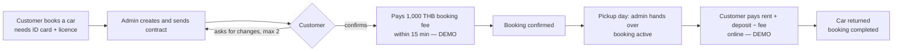
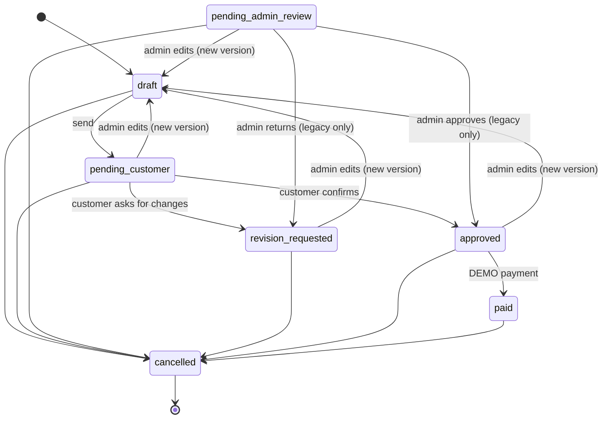
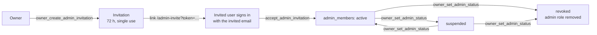
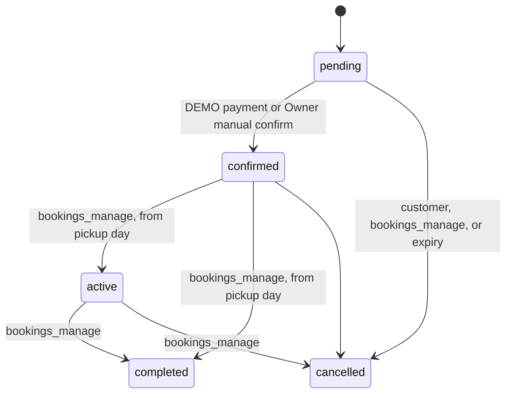
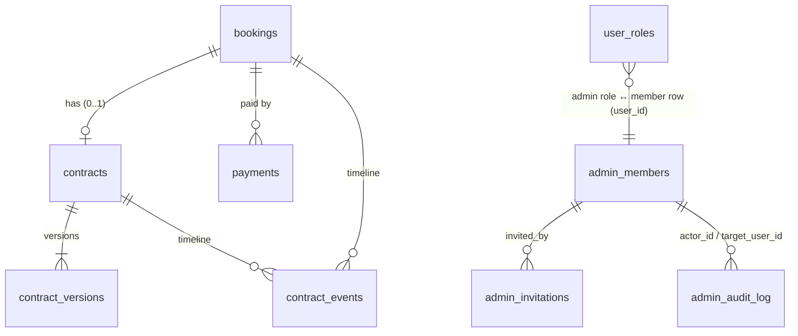

# Drive Dee — Siam Wheels Rental Hub

**Siam Wheels Rental Hub** is the car rental management system behind **Drive Dee**
(ไดร์ฟดี รถเช่า), a car rental service in Thailand. It covers online booking, a digital
contract approval workflow, demo payments, fleet and maintenance management, administrator
management and reporting.

- **Drive Dee** is the customer-facing brand (page titles end in "— Drive Dee").
- **Siam Wheels Rental Hub** is the name of the software and this repository.

The interface is in Thai, with an **English** switch (TH / EN button in the header) on every
page, customer and admin. Prices are in Thai Baht (THB) and all dates and times
use the Asia/Bangkok time zone. See [Languages](#languages) below.

> [!WARNING]
> **Prototype — payments are DEMO only.** No payment gateway is connected and **no real money
> is ever transferred**. See [Booking and payment workflow](#8-booking-and-payment-workflow).
> Do not enter real personal data (names, ID card or driving licence numbers, phone numbers,
> card details). Every page shows a Thai prototype notice saying the same.

### Languages

Text is written as pairs where it is used: `tr("ไทย", "English")` from
[`src/lib/i18n.tsx`](src/lib/i18n.tsx). Thai is the default and what the server renders; the
visitor's choice is saved in `localStorage` (`drive-dee-lang`) and applied after the page loads.
Admin pages switch too. Thai error messages from
the database are translated with `trError()`; pickup points, car transmission/fuel values and
status labels are translated for display only (the database still stores Thai).

---

## Contents

1. [Project overview](#1-project-overview)
2. [Main features](#2-main-features)
3. [Technology stack](#3-technology-stack)
4. [User roles and permissions](#4-user-roles-and-permissions)
5. [Contract approval workflow](#5-contract-approval-workflow)
6. [Contract versioning and revision requests](#6-contract-versioning-and-revision-requests)
7. [Admin management](#7-admin-management)
8. [Booking and payment workflow](#8-booking-and-payment-workflow)
9. [Database architecture](#9-database-architecture)
10. [Security and access control](#10-security-and-access-control)
11. [Installation and local development](#11-installation-and-local-development)
12. [Environment variables](#12-environment-variables)
13. [Testing and quality checks](#13-testing-and-quality-checks)
14. [Deployment guide](#14-deployment-guide)
15. [Current prototype limitations](#15-current-prototype-limitations)
16. [Future improvements](#16-future-improvements)

---

## 1. Project overview

A customer books a car online. The booking holds the car while an administrator prepares a
rental contract. The customer confirms the contract (or asks for changes), pays a fixed
1,000 THB booking fee (DEMO), and the booking is confirmed. On the pickup day the admin hands
the car over, the customer pays the rest online (DEMO), and the admin closes the rental when
the car comes back.



Every rule in this flow is enforced in PostgreSQL (functions, triggers and Row Level
Security), not only in the user interface. The workflow comes from
[`drizzle/migrations/0004_contract_approval_workflow.sql`](drizzle/migrations/0004_contract_approval_workflow.sql)
and [`0007_booking_fee_flow.sql`](drizzle/migrations/0007_booking_fee_flow.sql), plus the SQL
files in [`docs/database/`](docs/database/) listed in
[Database architecture](#9-database-architecture).

## 2. Main features

### Customers

- Sign-up, sign-in and password reset by email (Supabase Auth). Changing the password on the
  profile page asks for the current password first.
- Profile with contact details, address, ID card / passport number and driving licence
  number. Formats are checked in the browser and in the database (Thai ID check digit,
  passport, licence, phone).
- **An ID card / passport number and a driving licence number are required to book.** The
  car page shows what is missing with a link to the profile, and the database refuses the
  booking otherwise.
- Car search by date range, category and price; only cars free for the chosen dates are shown.
- Car detail page with specifications and a booking form with five pickup points
  (Bangkok Sukhumvit, Suvarnabhumi Airport, Don Mueang Airport, Chiang Mai, Phuket), showing
  the booking fee and the amount due at pickup.
- Booking with a server-generated booking code and a price calculated by the database.
- Contract review: read the contract sent by the administrator, **confirm** it or **ask for
  changes** (name, pickup and return time; at most 2 requests per contract); see the version
  history and contract timeline; print the contract.
- DEMO payments by QR code or test card: the 1,000 THB booking fee within 15 minutes of
  confirming, then the rest (rent + deposit − fee) once the admin has handed the car over.
- Receipt with the customer's full details (name, email, phone, ID card / passport, licence,
  address), booking code, contract number, the admin who created the contract, and both
  payments.
- Booking history with stage filters, and cancellation of pending or confirmed bookings.
- **Demo Customer** mode: a one-click account with a fictional name and fictional
  `DEMO…` ID card and licence numbers, so it can book straight away.

### Administrators (`/admin`)

Admins land on `/admin` after signing in.

- **Overview** with a contract **work queue** (bookings waiting for a contract, drafts, waiting
  for the customer, changes requested, waiting for payment, paid, cancelled), a card for
  **overdue hand-overs and returns**, and key metrics (revenue, fleet use, active bookings,
  customers, maintenance cost). Fleet counts come from today's bookings.
- **Contracts**: create, edit and send; apply a customer's requested name change
  (`admin_apply_requested_name`); view versions and events.
- **Bookings**: view all bookings and move them through `confirmed → active → completed` or
  cancel them. Hand-over (`active`) and return (`completed`) are allowed only from the
  pickup day. `pending → confirmed` is never offered by hand.
- **Customers**: view-only list of customers and their details.
- **Cars**: add, edit, delete, set status. Price must be above 0; seats, mileage and year
  have sane bounds.
- **Maintenance**: schedule and track jobs with costs (no negative costs, no completion date
  before the scheduled date).
- **Reports**: date-range filters (30 days, 90 days, this year, all time), monthly revenue
  chart split into online fees and pickup payments, CSV export (UTF-8 with BOM so Thai text
  opens in Excel). Revenue comes from recorded payments and excludes the refundable deposit;
  booking fees kept from cancelled bookings are counted.

### Owner only

- **Admin management** tab: invite administrators, set fine-grained permissions, suspend,
  reactivate or revoke them, revoke open invitations, read the audit log.
- **Manual booking confirmation**: confirm a pending booking without the contract/payment
  workflow, with a required reason. Logged in both the contract timeline and the audit log.

## 3. Technology stack

| Area                  | Technology                                                                   |
| --------------------- | ---------------------------------------------------------------------------- |
| Language              | TypeScript 5                                                                 |
| UI                    | React 19, Tailwind CSS 4, shadcn/ui (Radix UI), lucide-react                 |
| Application framework | TanStack Start (SSR) with TanStack Router (file-based routes)                |
| Data fetching         | TanStack Query 5, Supabase JS client 2                                       |
| Forms and validation  | React Hook Form, Zod                                                         |
| Charts and QR codes   | Recharts, qrcode.react                                                       |
| Backend               | Supabase (PostgreSQL, Auth, Row Level Security) provided by Lovable Cloud    |
| Schema tooling        | Drizzle Kit (migration files in `drizzle/migrations/`, managed by Lovable)   |
| Build                 | Vite 8, Nitro (Cloudflare Workers output)                                    |
| Testing               | Vitest 4, Testing Library, jsdom, PGlite (in-memory PostgreSQL for DB tests) |
| Code quality          | ESLint, Prettier, TypeScript                                                 |

The project is connected to [Lovable](https://lovable.dev), which hosts the database and the
published site. See [`AGENTS.md`](AGENTS.md) for what Lovable manages.

## 4. User roles and permissions

Roles are stored in `user_roles` (`app_role` enum: `admin`, `customer`). Administrator details
(Owner flag, status, permissions) are stored in `admin_members`.

| Role                    | How it is assigned                                                     | Access                                                                    |
| ----------------------- | ---------------------------------------------------------------------- | ------------------------------------------------------------------------- |
| Visitor                 | Not signed in                                                          | Home page, car search, car details                                        |
| **Customer**            | Every new sign-up (trigger `handle_new_user`)                          | Own profile, bookings, contracts and payments                             |
| Demo Customer           | "Demo Customer" button on `/auth`                                      | Same as Customer with fictional data; can never become an administrator   |
| **Admin**               | Accepting an Owner's invitation (or the one-time SQL setup, see below) | `/admin`, limited to the permissions in their `admin_members` row         |
| **Owner / Super Admin** | One-time `bootstrap_owner` SQL step on an existing admin               | Everything an admin can do, plus admin management and manual confirmation |
| Demo Admin              | **Disabled**                                                           | None. See [limitations](#15-current-prototype-limitations)                |

### Admin permissions

Each non-Owner admin has a subset of these permissions. The Owner implicitly has all of them.

| Permission          | Allows                                                                                                             |
| ------------------- | ------------------------------------------------------------------------------------------------------------------ |
| `contracts_manage`  | Create, edit and send contracts                                                                                    |
| `contracts_approve` | Approve or return legacy contracts left in `pending_admin_review` (no new contract reaches that status since 0007) |
| `bookings_manage`   | Change booking status                                                                                              |
| `fleet_manage`      | Add, edit, delete cars; create, edit, delete maintenance jobs                                                      |

All active admins can read the dashboard, contracts, bookings, maintenance and reports.
A **suspended** or **revoked** admin is not treated as an admin anywhere: `has_role()` returns
false for them, so every RLS policy and workflow function rejects them.

### Owner bootstrap (one-time privileged setup)

There is at most one Owner (enforced by a unique index). No application screen or API can
create one. The Owner is set **once**, by the project owner, in the Lovable Cloud SQL editor:

1. Make sure the target account is a verified, active admin. The full procedure (first admin,
   Owner bootstrap, invitations, permissions, suspension, revocation, audit) is in
   [`docs/database/admin-account-procedure.md`](docs/database/admin-account-procedure.md).
2. Run, replacing the placeholder:

   ```sql
   select public.bootstrap_owner('<OWNER_EMAIL>');
   ```

`bootstrap_owner` refuses to run when called by a signed-in user (it works only from the SQL
editor or service role), when an Owner already exists, or when the account is not an active
admin. It writes an `owner_bootstrapped` audit entry. Never run it from application code,
a migration or an automated agent.

## 5. Contract approval workflow

Contracts can only be changed through `security definer` database functions. Direct table
writes are revoked, and the trigger `guard_contract_update` rejects any status change outside
the allowed transitions.

Since migration 0007 the customer's confirmation opens payment directly; there is no
separate admin approval step. (Migration 0005 briefly made contracts self-service and 0006
rolled it back, so the live behaviour is 0004 plus 0007.)

```mermaid
sequenceDiagram
  autonumber
  actor C as Customer
  participant DB as Database
  actor A as Admin
  C->>DB: Insert booking (needs ID card + licence; pending, 24 h hold)
  A->>DB: admin_create_contract (contracts_manage) → draft v1
  A->>DB: admin_update_contract (optional edits while unsent)
  A->>DB: admin_send_contract → pending_customer
  C->>DB: customer_request_revision (optional, max 2) → revision_requested
  C->>DB: customer_accept_contract(version) → approved, 15 min payment window
  C->>DB: pay_booking (DEMO, 1,000 THB) → contract paid
  DB-->>C: Booking confirmed
  A->>DB: booking → active (from the pickup day)
  C->>DB: pay_pickup (DEMO, rent + deposit − fee)
  A->>DB: booking → completed
```

| Step                         | Function                   | Who                | Result                                                                                                        |
| ---------------------------- | -------------------------- | ------------------ | ------------------------------------------------------------------------------------------------------------- |
| 1. Admin creates contract    | `admin_create_contract`    | `contracts_manage` | Contract `draft`, version 1. Pickup/return dates must match the booking; price and days come from the booking |
| 2. Admin sends contract      | `admin_send_contract`      | `contracts_manage` | Version stamped `sent_at` (now immutable); contract `pending_customer`                                        |
| 3. Customer confirms         | `customer_accept_contract` | Booking owner      | Version stamped `accepted_at`; contract `approved`; 15-minute payment window starts                           |
| 4. Customer pays fee (DEMO)  | `pay_booking`              | Booking owner      | `payments` row, `kind = 'booking_fee'`, 1,000 THB (`booking_fee()`); contract `paid`; booking `confirmed`     |
| 5. Hand-over                 | booking status update      | `bookings_manage`  | Booking `active`, only on or after the pickup day                                                             |
| 6. Customer pays rest (DEMO) | `pay_pickup`               | Booking owner      | `payments` row, `kind = 'pickup'`: rent + deposit − fee; `deposit` column holds the refundable part           |
| 7. Return                    | booking status update      | `bookings_manage`  | Booking `completed`. The deposit refund is shown to the customer but not recorded                             |

Contract snapshot fields: customer full name and phone, driving licence number **only** if
the admin ticks "include licence", car, plate, pickup location, pickup/return time, rental
days and price, deposit (always equal to the rent), booking fee, amount due at pickup,
mileage allowance, late-return penalty and optional additional conditions. The national ID
number is never copied into contracts; it appears only on the receipt, from the profile.

Customers never see unsent drafts: RLS shows a customer their contract only once it has been
sent, only sent versions, and only customer-facing events.

### Contract statuses



A contract is cancelled automatically when its booking is cancelled or its hold expires
(trigger `cancel_contract_with_booking`).

## 6. Contract versioning and revision requests

Each contract has one or more rows in `contract_versions`. A version is a frozen snapshot.

- **Unsent draft:** `admin_update_contract` edits the draft in place.
- **Sent version:** never overwritten. `admin_update_contract` marks it `superseded_at` and
  creates version _n + 1_ as a new draft. The contract goes back to `draft` and acceptance and
  approval are cleared, so the new version needs a new send, acceptance and approval.
- Only one live (non-superseded) version per contract (unique index).
- Trigger `protect_contract_version` makes sent versions immutable, makes the
  sent/accepted/approved/superseded stamps write-once, and blocks deleting sent versions.
- Customers confirm a **specific version number**. A stale page
  (wrong version) is rejected.
- Payment requires the current version to be sent, confirmed by the booking's customer
  and not superseded. The booking fee is always `booking_fee()` (1,000 THB).

### Revision requests

| Who      | Function                    | When allowed                         | Permission          |
| -------- | --------------------------- | ------------------------------------ | ------------------- |
| Customer | `customer_request_revision` | `pending_customer`                   | Booking owner       |
| Admin    | `admin_request_revision`    | `pending_admin_review` (legacy only) | `contracts_approve` |

- A customer may ask for changes **at most 2 times per contract** (each request renews the
  hold, so the limit stops a car being held without paying).
- The request must change something: the same name, pickup and return time as the sent
  version is refused and does not use up a request.
- The reason is stored in `contracts.revision_reason` with `revision_requested_by` and
  logged as a `revision_requested` event.
- A requested name change is **not** written to the profile by the customer. The admin
  applies it with `admin_apply_requested_name`, which accepts only the exact name in the
  open request.
- The admin then edits the contract, which creates a new version, and sends it again.

### Contract events

`contract_events` is an append-only timeline (updates and deletes are rejected by trigger).
Actions: `legacy_import`, `created`, `edited`, `sent`, `accepted`, `revision_requested`,
`approved`, `paid`, `cancelled`, `expired`, `manual_confirm`. Each event records the version,
actor and actor role (`owner`, `admin`, `customer`, `system`). Customers see every action
except `created` and `edited`.

## 7. Admin management

All admin management functions require the Owner (`require_owner()`), except accepting an
invitation. The Owner uses the **ผู้ดูแลระบบ (Owner)** tab in `/admin`.



### Admin invitations

- The Owner enters an email and at least one permission. The database generates a random
  token, stores **only its SHA-256 hash**, and returns the token **once**.
- The UI shows a link `/admin-invite?token=…` that the Owner copies and sends to the invitee
  through their own channel. The app does not send email.
- Invitations cannot target `@demo.siamwheels.invalid` addresses or someone who is already an
  active or suspended admin.

### Expiration and single-use rules

- An invitation expires **72 hours** after creation.
- It can be accepted **once**; `accepted_at` / `accepted_by` are then set.
- It is valid only for a signed-in account whose email equals the invited email
  (case-insensitive), and never for a Demo Customer account.
- Only one open invitation per email: creating a new one revokes the previous open one.
- The Owner can revoke an open invitation (`owner_revoke_admin_invitation`).
- Expired, accepted, revoked, wrong-account and unknown tokens all fail with the same message.

### Permission management

`owner_set_admin_permissions` replaces a non-Owner admin's permission set. The list is
validated against the four known permissions and must not be empty. The Owner's own
permissions cannot be changed.

### Suspension and revocation

`owner_set_admin_status` requires a reason (at least 5 characters). Allowed moves:

| From                   | To          | Effect                                                   |
| ---------------------- | ----------- | -------------------------------------------------------- |
| `active`               | `suspended` | All admin access stops immediately (`has_role` is false) |
| `suspended`            | `active`    | Access restored with the existing permissions            |
| `active` / `suspended` | `revoked`   | `admin` role deleted from `user_roles`; access ends      |

The Owner cannot change their own status, and the Owner's status cannot be changed. A revoked
admin can be invited again.

### Audit logs

`admin_audit_log` is append-only and readable only by the Owner (latest 100 entries are shown
in the UI). Actions: `admin_role_granted`, `owner_bootstrapped`, `invite_created`,
`invite_revoked`, `invite_accepted`, `permissions_changed`, `admin_suspended`,
`admin_reactivated`, `admin_revoked`, `booking_manual_confirm`. Each entry stores the actor,
target user and email, and a JSON `details` object (for example old and new permissions or the
reason). Invitation tokens are never logged.

## 8. Booking and payment workflow

### Booking hold

A pending booking holds its car only while `bookings.hold_expires_at` is in the future
(`booking_blocks_car`). The hold is reset at every hand-off:

| Stage                                             | Hold                                                     |
| ------------------------------------------------- | -------------------------------------------------------- |
| Booking created, waiting for the admin's contract | 24 h, capped at midnight after the pickup date (Bangkok) |
| Sent, waiting for the customer                    | 24 h (same cap)                                          |
| Revision requested / new version                  | 24 h (same cap)                                          |
| Confirmed, waiting for the booking fee            | **15 minutes** (not capped)                              |

When a hold runs out the car is released at once for availability checks, and every workflow
step on that booking is refused. `expire_stale_bookings()` (called by the app when lists load)
moves such bookings to `cancelled` and logs an `expired` contract event.

`validate_booking` (trigger) also rejects bookings from customers without an ID card /
passport and a licence number in their profile, past dates, unavailable cars and overlapping
bookings; computes days and price; prevents customers from changing amount, dates or car;
locks those fields for admins once a contract exists; and allows `active` / `completed` only
from the pickup day.

### Booking statuses



### DEMO payments

> [!IMPORTANT]
> **DEMO payments do not transfer real money.** There is no payment gateway, no card
> processing and no bank transfer. Refunds are recorded only.

| Payment (`payments.kind`) | When                                       | Amount                                | Function      |
| ------------------------- | ------------------------------------------ | ------------------------------------- | ------------- |
| `booking_fee`             | Within 15 minutes of confirming            | 1,000 THB (`booking_fee()`)           | `pay_booking` |
| `pickup`                  | After the admin marks the booking `active` | rent + deposit (= rent) − booking fee | `pay_pickup`  |

- **QR code:** contains a text marker (`SIAM-WHEELS-DEMO|NOT-A-PAYMENT|…`), deliberately not
  a PromptPay/EMVCo payload, so a banking app cannot turn it into a transfer. The customer
  confirms the simulated payment with a button.
- **Card:** test cards only. `4242 4242 4242 4242` succeeds; any number ending in `0002`
  (for example `4000 0000 0000 0002`) is declined in the browser and the database is not
  called. Use any future expiry and any 3-digit CVV. Only the last four digits are stored.
- Each payment gets a `DEMO-` reference; a unique index allows one `paid` payment of each
  kind per booking. `payments.deposit` is the refundable deposit inside a pickup payment and
  is excluded from revenue.
- **Cancellation:** the booking fee is never refunded (`refund_status = 'not_refunded'`).
  `pickup-refund.sql` marks a pickup payment `refunded` if the booking is cancelled before
  hand-over, but since `pickup-at-handover.sql` the pickup payment can only be made after
  hand-over, so in practice nothing is refunded automatically. No money moves either way.
- **Receipt:** once paid, the booking page shows a receipt with the customer's details, the
  contract number, the admin who created the contract (`booking_receipt_details`) and both
  payments.

## 9. Database architecture

Schema `public`, created by `drizzle/migrations/0000`–`0007`, all applied to production
(0005 and 0006 cancel each other out). Other tables: `profiles`, `cars`, `maintenance`. (`reviews` was dropped by
`docs/database/drop-reviews.sql` when the review feature was removed.)

These files in `docs/database/` are **also applied to production**. They were run directly
with the database query tool and are **not yet recorded as Drizzle migrations**; each is
re-runnable, and the live function bodies were checked against the files:

| File                          | Adds                                                                                              |
| ----------------------------- | ------------------------------------------------------------------------------------------------- |
| `revision-limits.sql`         | Max 2 customer change requests; `admin_apply_requested_name`                                      |
| `pickup-day-status.sql`       | Hand-over / return only from the pickup day                                                       |
| `pickup-payment.sql`          | `payments.kind`, `payments.deposit`, one paid payment per kind, `pay_pickup`                      |
| `pickup-refund.sql`           | Pickup payment refunded when cancelled before hand-over (superseded in practice by the next file) |
| `pickup-at-handover.sql`      | `pay_pickup` only once the booking is `active`                                                    |
| `input-validation.sql`        | Car CHECK constraints, profile field formats, "nothing changed" revision check                    |
| `booking-documents.sql`       | ID card + licence required to book; `booking_receipt_details` for the receipt                     |
| `drop-reviews.sql`            | Drops the unused `reviews` table                                                                  |
| `drop-reviews-permission.sql` | Removes the `reviews_moderate` admin permission (list, rows, default, CHECKs)                     |



| Table               | Purpose and key rules                                                                                                                                                                                                                                                                                   |
| ------------------- | ------------------------------------------------------------------------------------------------------------------------------------------------------------------------------------------------------------------------------------------------------------------------------------------------------- |
| `contracts`         | One per booking. `contract_no`, `status` (7 values), `current_version`, `sent_version`, `terms` (text of the sent version), `customer_accepted_at`, `approved_at/by`, `paid_at`, `cancelled_at`, `revision_reason`, `revision_requested_by`. Read-only for clients; changed only by workflow functions. |
| `contract_versions` | Immutable snapshots per version (customer, car, times, price, deposit, mileage, penalty, conditions, rendered `terms`) with `sent_at`, `accepted_at/by`, `approved_at/by`, `superseded_at`. `is_legacy` marks contracts imported from before migration 0004.                                            |
| `contract_events`   | Append-only timeline per booking/contract: action, version, actor, actor role, note.                                                                                                                                                                                                                    |
| `admin_members`     | One row per admin: `is_owner` (at most one), `status` (`active`/`suspended`/`revoked`), `permissions`, `status_reason`, `invited_by`. Created automatically when the admin role is granted. Updated by Owner functions (not append-only).                                                               |
| `admin_invitations` | `email`, `token_hash` (SHA-256, never the token), `permissions`, `expires_at`, `accepted_at/by`, `revoked_at/by`. One open invitation per email. Acceptance and revocation update the row (not append-only).                                                                                            |
| `admin_audit_log`   | Append-only log of admin-management actions and manual confirmations. Owner-readable only.                                                                                                                                                                                                              |
| `bookings`          | `booking_code`, customer, car, dates, `days`, `pickup_location`, `total_amount`, `status`, `hold_expires_at`.                                                                                                                                                                                           |
| `payments`          | DEMO payments: `kind` (`booking_fee`/`pickup`), `method` (`qr`/`card`), `amount`, `deposit`, `status`, `reference`, `card_last4`, `refund_status` (`none`/`not_refunded`/`refunded`). Client writes revoked; one `paid` row per kind per booking.                                                       |
| `user_roles`        | `(user_id, role)` with `app_role` = `admin` or `customer`. Client writes revoked; `admin` can only be granted by an accepted invitation or from the SQL editor.                                                                                                                                         |

Key database functions:

| Group             | Functions                                                                                                                                                                                                                                  |
| ----------------- | ------------------------------------------------------------------------------------------------------------------------------------------------------------------------------------------------------------------------------------------ |
| Contract workflow | `admin_create_contract`, `admin_update_contract`, `admin_send_contract`, `customer_accept_contract`, `customer_request_revision`, `admin_apply_requested_name`, `admin_approve_contract` / `admin_request_revision` (legacy)               |
| Booking / payment | `pay_booking`, `pay_pickup`, `booking_fee`, `booking_receipt_details`, `owner_manual_confirm_booking`, `expire_stale_bookings`, `booked_car_ids`                                                                                           |
| Admin management  | `owner_create_admin_invitation`, `owner_revoke_admin_invitation`, `accept_admin_invitation`, `owner_set_admin_permissions`, `owner_set_admin_status`, `bootstrap_owner` (SQL editor only)                                                  |
| Authorisation     | `has_role`, `is_owner`, `has_admin_permission`                                                                                                                                                                                             |
| Triggers          | `validate_booking`, `cancel_contract_with_booking`, `guard_contract_update`, `protect_contract_version`, `append_only`, `guard_admin_role_grant`, `track_admin_member`, `prevent_demo_admin`, `handle_new_user`, `validate_profile_fields` |

Migration 0004 is additive: existing contracts were kept as legacy version 1 and mapped to
`paid` or `cancelled`, existing admins became active members with all permissions (none was
made Owner), and existing pending bookings kept a 15-minute hold. A rollback script is kept in
[`docs/database/contract-approval-workflow-rollback.sql`](docs/database/contract-approval-workflow-rollback.sql).

> Schema changes are drafted in `docs/database/`, tested with the PGlite database tests, and
> applied through Lovable. Do not add or edit files in `drizzle/` by hand.

## 10. Security and access control

- **The database is the security boundary.** The UI hides actions a user cannot perform
  (`src/lib/roles.ts`), but RLS policies, grants, triggers and function checks reject them if
  attempted directly through the API.
- **Row Level Security** is enabled on every table. Customers read only their own bookings,
  payments, contracts (once sent), sent versions and customer-facing events.
- **No direct writes** for clients on `contracts`, `contract_versions`, `contract_events`,
  `payments`, `user_roles`, `admin_members`, `admin_invitations` or `admin_audit_log`. Writes
  go through `security definer` functions that check identity and permissions themselves.
- **Fine-grained admin permissions** are enforced in RLS (`has_admin_permission`) for cars,
  maintenance, and in each workflow function for contracts and bookings.
- **Admin role grants** are blocked for signed-in users unless they come from
  `accept_admin_invitation` (`guard_admin_role_grant`). Demo accounts can never be admins
  (`prevent_demo_admin` and checks in invitation functions).
- **Owner-only actions** call `require_owner()`. `bootstrap_owner` cannot be executed by any
  API role.
- **Append-only history:** `contract_events` and `admin_audit_log` reject every update and
  delete (trigger `append_only`). Sent contract versions are immutable and their
  sent/accepted/approved/superseded stamps are write-once. `admin_members` and
  `admin_invitations` are **not** append-only: the Owner functions update status, permissions
  and acceptance/revocation columns, and those changes are recorded in `admin_audit_log`.
  (Grant comments in migration 0004 call these two tables "append-only history"; that only
  means `service_role` has no `UPDATE`/`DELETE`/`TRUNCATE` grant on them.)
- **Internal helpers** (rendering, logging, permission checks) have `EXECUTE` revoked from
  API roles.
- **Invitation tokens** are 64 hex characters from the database's cryptographic random
  source; only the hash is stored and the token is never logged.
- **Demo Customer accounts** use the reserved domain `@demo.siamwheels.invalid` and a
  server-set `app_metadata.demo` flag; the app always treats them as customers.
- **Service-role key** is used only in the `createDemoAccount` server function
  (`src/lib/demo.functions.ts`) through `src/integrations/supabase/client.server.ts`. It must
  never reach browser code.

## 11. Installation and local development

Requirements: Node.js 20.19 or later (22 LTS recommended) and npm.

```sh
git clone https://github.com/newn26/drive-dee.git
cd drive-dee
npm install
npm run dev
```

The app runs at http://localhost:8080. The committed `.env` contains only public values (see
below), so the app connects to the Lovable Cloud backend without further setup. Demo Customer
sign-in needs the service-role key and does not work locally without it.

| Command              | Description                             |
| -------------------- | --------------------------------------- |
| `npm run dev`        | Development server on port 8080         |
| `npm run build`      | Production build (output in `.output/`) |
| `npm run build:dev`  | Build in development mode               |
| `npm test`           | Run all tests once                      |
| `npm run test:watch` | Tests in watch mode                     |
| `npm run lint`       | ESLint                                  |
| `npm run format`     | Prettier                                |
| `npx tsc --noEmit`   | Type-check                              |

`npm run preview` does not serve the Cloudflare Worker output; use `npm run dev`.

Project layout:

```
drizzle/migrations/       SQL migrations (managed by Lovable; do not edit)
docs/database/            Proposed / directly applied SQL, workflow plan, owner procedures
src/routes/               One file per page (see src/routes/README.md)
src/components/admin/     Contracts panel, admin management panel, customers panel
src/components/contract/  Contract view (versions, events, print)
src/lib/                  Domain logic: contract workflow/API, roles, payment window,
                          demo payment, availability, reports, formatting
src/integrations/supabase Supabase clients and generated types (generated; do not edit)
src/test/                 Unit/UI tests; src/test/db/ holds database tests (PGlite)
```

## 12. Environment variables

### Used by the application

| Variable                        | Where                                                    | Used by                                                                     | Purpose                                           |
| ------------------------------- | -------------------------------------------------------- | --------------------------------------------------------------------------- | ------------------------------------------------- |
| `VITE_SUPABASE_URL`             | `.env` (committed, public)                               | Browser build (`client.ts`)                                                 | Supabase project URL                              |
| `VITE_SUPABASE_PUBLISHABLE_KEY` | `.env` (committed, public)                               | Browser build (`client.ts`)                                                 | Publishable key; access limited by RLS            |
| `SUPABASE_URL`                  | `.env` / runtime                                         | Server (`client.ts` SSR fallback, `auth-middleware.ts`, `client.server.ts`) | Supabase URL for server-side requests             |
| `SUPABASE_PUBLISHABLE_KEY`      | `.env` / runtime                                         | Server (`client.ts` SSR fallback, `auth-middleware.ts`)                     | Publishable key for server-side requests          |
| `SUPABASE_SERVICE_ROLE_KEY`     | **Runtime secret only** (Lovable secrets / `.env.local`) | Server only (`client.server.ts`, used by `createDemoAccount`)               | Creates Demo Customer accounts. Bypasses all RLS. |

### Tooling and tests

| Variable                   | Used by                  | Purpose                                                                        |
| -------------------------- | ------------------------ | ------------------------------------------------------------------------------ |
| `LOVABLE_DB_MIGRATION_URL` | `drizzle.config.ts`      | Database URL for Drizzle Kit. Provided and used by Lovable; not needed locally |
| `CONTRACT_MIGRATION_SQL`   | `src/test/db/harness.ts` | Optional: path to an alternative migration file for the database tests         |

### Present but currently unused

| Variable                                              | Status                                                                                                                                                               |
| ----------------------------------------------------- | -------------------------------------------------------------------------------------------------------------------------------------------------------------------- |
| `VITE_SUPABASE_PROJECT_ID`, `SUPABASE_PROJECT_ID`     | In the committed `.env` (written by Lovable). Not read by application code. Vite still embeds `VITE_SUPABASE_PROJECT_ID` in the browser bundle; the value is public. |
| `LOVABLE_CRON_SECRET`, `LOVABLE_CRON_SECRET_PREVIOUS` | Read only by the generated helper `src/integrations/supabase/cron-auth.ts`, which nothing imports. There are no cron routes or scheduled jobs.                       |

> [!CAUTION]
> **Never commit `SUPABASE_SERVICE_ROLE_KEY` or any other secret.** It bypasses all database
> security. Keep it in Lovable's secret store or a git-ignored `.env.local`, out of browser code,
> chats and issue trackers. Only `VITE_*` values may reach the browser.

## 13. Testing and quality checks

39 test files, 359 tests (Vitest).

- **Unit and UI tests** (`src/test/*.test.ts(x)`, jsdom): roles and dashboard permissions,
  protected routes, contract status rules and UI, contract terms, payment window and countdown,
  DEMO payment helpers, availability and dates, car status, reports and CSV,
  password reset, prototype notice, error states.
- **Database tests** (`src/test/db/*.db.test.ts`): boot an **in-memory PostgreSQL (PGlite)**
  with Supabase stubs, apply migrations 0000–0004 (or 0000–0007 with `applyLater: true`),
  apply the `docs/database/*.sql` file under test on top, and run queries as real `authenticated`
  users so RLS, grants, triggers and functions are exercised. They cover contract creation and
  review, versioning and revisions, payment, hold and booking rules, admin management and
  invitations, booking fee and pickup payments, refunds, revision limits, input validation,
  ID card / licence and receipt details, legacy data migration, and the rollback script.
  They never connect to the live database.

```sh
npm test            # all tests
npx tsc --noEmit    # type-check
npm run lint        # lint
npm run build       # production build
```

## 14. Deployment guide

The site is hosted by Lovable Cloud, which syncs the `main` branch of this repository.

1. Open a pull request into `main` and make sure `npm test`, `npx tsc --noEmit` and
   `npm run build` pass. Do not force-push or rewrite pushed history (see `AGENTS.md`).
2. Merge. Lovable syncs the commit; confirm in the Lovable editor that the preview works.
3. Apply database changes **before** merging UI that needs them. Draft the SQL in
   `docs/database/`, test it with the PGlite database tests, then apply it through Lovable
   and check that the live function bodies match the file.
4. In Lovable Cloud → Auth settings, include the published domain in Site URL and Redirect URLs
   so confirmation and password-reset emails return to the site.
5. Keep secrets in Lovable's secret store. Only the publishable key may reach the browser.
6. Run Lovable's security scan and resolve critical findings.
7. Publish from the Lovable editor and test the published URL signed out (home, search,
   `/admin` access denied), as a customer (booking → contract → booking fee → pickup
   payment) and as an admin.
8. First deployment of the admin model only: run the one-time
   [Owner bootstrap](#owner-bootstrap-one-time-privileged-setup).

The Lovable preview URL is visible only to workspace members; share the published URL with
clients.

## 15. Current prototype limitations

- **Payments are DEMO only.** No gateway, no real money. Refunds and the deposit return are
  recorded or shown only.
- **ID card and licence numbers are checked for format only**, not verified against any
  official source.
- **Nine `docs/database/*.sql` files are live but not Drizzle migrations** (see
  [Database architecture](#9-database-architecture)); a fresh database built from
  `drizzle/migrations/` alone would miss them.
- **No email notifications.** Invitation links must be copied and delivered by the Owner;
  customers and admins are not notified of contract steps.
- **Expiry is enforced on use.** Expired holds stop blocking cars immediately, but booking
  status changes to `cancelled` only when `expire_stale_bookings()` runs (when lists load).
  There is no scheduled job.
- **Single Owner, no transfer.** There is no function to transfer or remove the Owner role
  from the app.
- **Demo Administrator is not available.** `/demo-admin` exists, but the `demo_admin` role is
  not in the database and its sign-in is disabled (`DEMO_ADMIN_SIGN_IN_ENABLED = false`).
- **Demo Customer accounts** are created without rate limiting and need the service-role key.
- Car images are URLs or category stock photos; no upload.
- Email and password sign-in only. In English mode the contract text, CSV exports, page
  titles and data typed in by staff (car descriptions, names) stay Thai.

## 16. Future improvements

- Real payment provider (for example PromptPay and cards through a licensed gateway) with
  real refunds and deposit returns.
- Record the `docs/database/*.sql` files as Lovable/Drizzle migrations.
- Email notifications for invitations, contract sends, approvals and payment reminders.
- Scheduled job for expiring holds and updating car status.
- Owner transfer procedure.
- Apply the Demo Administrator migration and enable its sign-in.
- Rate limiting and clean-up for Demo Customer accounts.
- End-to-end browser tests (for example Playwright) in CI.
- Car image upload to storage.
