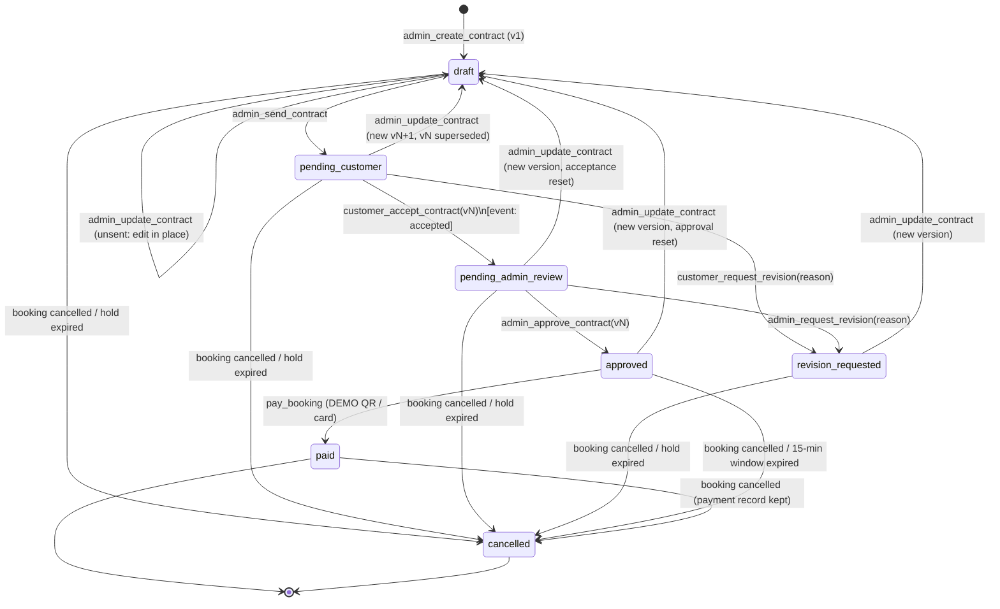

# Contract approval workflow — Phase C plan

Status: **Phase E prepared on branch `contract-approval-workflow` (not pushed). Migration NOT applied.**
See the Phase E addendum at the end for what changed after the plan. Prepared 2026-11-12 for Drive Dee (Siam Wheels prototype).
No SQL has been executed, no migration applied, no app code changed, nothing committed.

Decisions taken (from the owner, 2026-11-12):

1. New contracts start as `draft`; the Admin must press **Send**; customers never see unsent drafts.
2. Stage-based hold: 24 h admin draft/send (from booking creation), 24 h customer review, 24 h admin review, 15 min payment after approval. Reset at each handoff.
3. Customer revision requests use `revision_requested` with a reason. New version → new acceptance → new approval.
4. Contract snapshot: full name, phone, driving licence number only when the Admin ticks "include". No national ID.

This plan also **supersedes** `security-fixes-lovable-prompt.md` (fixes B and H are folded in below). Do not apply both.

---

## 1. Implementation plan

| Step | What | Touches live DB? | Needs approval |
|---|---|---|---|
| E0 | New branch `contract-approval-workflow` from `origin/main`. `main` is never modified directly. | No | — |
| E1 | Isolated test database harness (in-memory Postgres, see §9). Save the SQL in §3 as `docs/database/contract-approval-workflow.sql`. Write the database tests (§9) and iterate the SQL until they pass. | No | Report back if the SQL changes materially |
| E2 | Pure workflow module `src/lib/contract-workflow.ts` (statuses, labels, allowed transitions, `canPay`, `canAccept`, hold countdown) + unit tests. | No | — |
| E3 | Typed RPC wrapper `src/lib/contract-api.ts` with local types, so the branch compiles **before** Lovable regenerates `types.ts` (the generated file is never hand-edited). | No | — |
| E4 | UI: customer booking page + lists, admin contracts panel, admin booking-status restrictions + manual-confirm dialog (§6). UI tests. | No | — |
| E5 | Full local gate: `tsc --noEmit`, `eslint`, `vitest run` (all old + new tests), `vite build`. | No | — |
| E6 | Read-only pre-checks (§3.0) on live, then send the migration to Lovable (`send_message`, uses credits). Lovable writes `drizzle/migrations/0004_*` and regenerates `types.ts`. Read-only post-checks (§3.3). | **Yes** | **Yes — explicit** |
| E7 | Remove the temporary local types in `contract-api.ts`, re-run E5, open PR to `main`. You merge; then Lovable *Publish → Update*. | No | You merge |
| E8 | Optional live smoke test with a fictional Demo Customer account only. | Writes test bookings | **Yes — explicit**, or skip |

**Deployment gap.** Between E6 (DB migrated) and E7 (new code live), the old app runs against the new DB:
old checkout cannot pay (pay now requires an approved contract) and old contract-text editing is refused.
Nothing is corrupted; keep the gap short (merge right after the migration). Live today has **0 pending bookings**, so no customer is mid-payment.

---

## 2. Final database schema proposal

### 2.1 `bookings` (1 new column)

| Column | Type | Meaning |
|---|---|---|
| `hold_expires_at` | `timestamptz null` | Until when an unpaid (`pending`) booking holds the car. Null once confirmed/cancelled. Replaces every hard-coded `created_at + 15 min`. |

### 2.2 `contracts` (kept: one workflow row per booking; `booking_id` stays **unique**)

Existing columns stay. `terms` and `customer_accepted_at` become **mirrors of the latest version sent to the customer**, so existing print / list code keeps working.

| New column | Type | Meaning |
|---|---|---|
| `current_version` | `int not null default 1` | Newest version (may be an unsent draft) |
| `sent_version` | `int null` | Newest version the customer has been sent. Null = customer cannot see the contract at all |
| `approved_at`, `approved_by` | `timestamptz`, `uuid` | Approval of the current version (cleared when a new version starts) |
| `paid_at` | `timestamptz` | When DEMO payment succeeded |
| `cancelled_at` | `timestamptz` | When cancelled/expired |
| `revision_reason` | `text` | Latest revision reason |
| `revision_requested_by` | `text` (`customer`/`admin`) | Who asked |
| `updated_at` | `timestamptz not null default now()` | |

`status` gets a check constraint (no new enum; there is no existing contract-status enum to duplicate):
`draft, pending_customer, pending_admin_review, revision_requested, approved, paid, cancelled`.
Default changes from `'active'` to `'draft'`.

### 2.3 `contract_versions` (new, immutable once sent)

One row per version. Content columns (snapshot + terms) are editable only while `sent_at is null`.
Stamp columns (`sent_at`, `accepted_*`, `approved_*`, `superseded_at`) can only go from null to a value, never change.

Snapshot: `customer_name`, `customer_phone`, `customer_license_no` (only if included), `car_label`, `car_plate_no`,
`pickup_location`, `pickup_at`, `return_at`, `rental_days`, `rental_price`, `deposit`, `mileage_allowance`,
`late_penalty`, `additional_conditions`, rendered `terms`. **No `id_card_no`.**
Legacy rows (`is_legacy = true`) carry only the original `terms` text — nothing is invented for them.

Acceptance is linked to the exact version: `accepted_at` + `accepted_by` live **on the version row**.
Approval likewise. A partial unique index allows only one non-superseded version per contract.

### 2.4 `contract_events` (new, append-only audit log)

`contract_id` (null for a manual confirm with no contract), `booking_id`, `version`, `actor_id`, `actor_role`
(`admin`/`customer`/`system`), `action`, `note`, `created_at`. Actions:
`legacy_import, created, edited, sent, accepted, revision_requested, approved, paid, cancelled, expired, manual_confirm`.
Supplies badge timestamps, revision reasons and the manual-confirm audit trail.

### 2.5 `payments`

Partial unique index: at most one `paid` payment per booking (database-level duplicate guard).

---

## 3. Exact SQL migration

### 3.0 Read-only pre-checks (E6, before sending to Lovable)

```sql
-- Expected today: contracts active=1 / accepted=7; bookings cancelled=4 / confirmed=6; payments paid=8
select 'contract' k, status v, count(*) from public.contracts group by status
union all select 'booking', status::text, count(*) from public.bookings group by status
union all select 'payment', status, count(*) from public.payments group by status;

-- Must be 0 rows: a paid payment duplicated (would break the unique index)
select booking_id from public.payments where status = 'paid' group by booking_id having count(*) > 1;

-- Must be 0 rows: a legacy contract without a paid payment (legacy mapping assumes all were paid)
select c.contract_no from public.contracts c
where not exists (select 1 from public.payments p where p.booking_id = c.booking_id and p.status = 'paid');

-- Expected 0: pending bookings (they would get a 15-minute hold from created_at)
select count(*) from public.bookings where status = 'pending';

-- Must be 0 rows: nothing from this migration exists yet
select table_name from information_schema.tables
 where table_schema = 'public' and table_name in ('contract_versions','contract_events');
select column_name from information_schema.columns
 where table_schema = 'public' and table_name = 'bookings' and column_name = 'hold_expires_at';
```

### 3.1 Migration `0004_contract_approval_workflow`

```sql
-- =====================================================================
-- Drive Dee: admin-created contract approval workflow (prototype)
-- Additive: no table, column or row is deleted. Existing contracts are
-- kept and mapped to the new statuses with an immutable version 1.
-- =====================================================================

-- ---------------------------------------------------------------------
-- 1. Booking hold
-- ---------------------------------------------------------------------
alter table public.bookings add column if not exists hold_expires_at timestamptz;

-- Pending bookings that exist right now keep today's 15-minute rule.
update public.bookings set hold_expires_at = created_at + interval '15 minutes'
where status = 'pending' and hold_expires_at is null;

create index if not exists bookings_pending_hold_idx
  on public.bookings (car_id, hold_expires_at) where status = 'pending';

-- Review-stage hold: now + span, but never past midnight after the pickup date (Bangkok).
create or replace function public.contract_hold_until(_start_date date, _span interval)
returns timestamptz language sql stable set search_path = public as $$
  select least(now() + _span, ((_start_date + 1)::timestamp at time zone 'Asia/Bangkok'))
$$;

-- The one rule for "does this booking hold the car right now".
create or replace function public.booking_blocks_car(_status public.booking_status, _hold_expires_at timestamptz)
returns boolean language sql stable set search_path = public as $$
  select _status in ('confirmed','active') or (_status = 'pending' and _hold_expires_at > now())
$$;

create or replace function public.booked_car_ids(_start date, _end date)
returns setof uuid language sql stable security definer set search_path = public as $$
  select distinct car_id from public.bookings
  where public.booking_blocks_car(status, hold_expires_at)
    and daterange(start_date, end_date, '[]') && daterange(_start, _end, '[]')
$$;

-- ---------------------------------------------------------------------
-- 2. Contracts: new columns, versions, events
-- ---------------------------------------------------------------------
alter table public.contracts
  add column if not exists current_version int not null default 1,
  add column if not exists sent_version int,
  add column if not exists approved_at timestamptz,
  add column if not exists approved_by uuid,
  add column if not exists paid_at timestamptz,
  add column if not exists cancelled_at timestamptz,
  add column if not exists revision_reason text,
  add column if not exists revision_requested_by text,
  add column if not exists updated_at timestamptz not null default now();
alter table public.contracts alter column status set default 'draft';

create table if not exists public.contract_versions (
  id uuid primary key default gen_random_uuid(),
  contract_id uuid not null references public.contracts(id) on delete cascade,
  version int not null check (version >= 1),
  is_legacy boolean not null default false,
  customer_name text,
  customer_phone text,
  customer_license_no text,
  car_label text,
  car_plate_no text,
  pickup_location text,
  pickup_at timestamptz,
  return_at timestamptz,
  rental_days int,
  rental_price numeric(10,2) check (rental_price >= 0),
  deposit numeric(10,2) check (deposit >= 0),
  mileage_allowance text,
  late_penalty text,
  additional_conditions text not null default '',
  terms text not null,
  created_by uuid,
  created_at timestamptz not null default now(),
  sent_at timestamptz,
  accepted_at timestamptz,
  accepted_by uuid,
  approved_at timestamptz,
  approved_by uuid,
  superseded_at timestamptz,
  constraint contract_versions_unique unique (contract_id, version),
  constraint contract_versions_fields check (is_legacy or (
    customer_name is not null and car_label is not null and car_plate_no is not null
    and pickup_location is not null and pickup_at is not null and return_at is not null
    and rental_days is not null and rental_price is not null and deposit is not null
    and mileage_allowance is not null and late_penalty is not null)),
  constraint contract_versions_times check (pickup_at is null or return_at is null or return_at > pickup_at),
  constraint contract_versions_accept_pair check ((accepted_at is null) = (accepted_by is null)),
  constraint contract_versions_approve_pair check ((approved_at is null) = (approved_by is null)),
  constraint contract_versions_accept_needs_send check (accepted_at is null or sent_at is not null),
  constraint contract_versions_approve_needs_accept check (approved_at is null or accepted_at is not null)
);
create unique index if not exists contract_versions_one_live
  on public.contract_versions (contract_id) where superseded_at is null;

create table if not exists public.contract_events (
  id uuid primary key default gen_random_uuid(),
  contract_id uuid references public.contracts(id) on delete cascade,
  booking_id uuid not null references public.bookings(id) on delete cascade,
  version int,
  actor_id uuid,
  actor_role text not null check (actor_role in ('admin','customer','system')),
  action text not null check (action in ('legacy_import','created','edited','sent','accepted',
    'revision_requested','approved','paid','cancelled','expired','manual_confirm')),
  note text,
  created_at timestamptz not null default now()
);
create index if not exists contract_events_contract_idx on public.contract_events (contract_id, created_at);
create index if not exists contract_events_booking_idx on public.contract_events (booking_id, created_at);

-- ---------------------------------------------------------------------
-- 3. Keep existing contracts (before any guard trigger exists)
-- ---------------------------------------------------------------------
insert into public.contract_versions (contract_id, version, is_legacy, terms, created_at, sent_at, accepted_at, accepted_by)
select c.id, 1, true, c.terms, c.created_at, c.created_at, c.customer_accepted_at,
       case when c.customer_accepted_at is not null then c.user_id end
from public.contracts c
where not exists (select 1 from public.contract_versions v where v.contract_id = c.id);

insert into public.contract_events (contract_id, booking_id, version, actor_role, action, note, created_at)
select c.id, c.booking_id, 1, 'system', 'legacy_import',
       'สัญญาเดิมก่อนระบบอนุมัติสัญญา (สถานะเดิม: ' || c.status || ')', c.created_at
from public.contracts c
where c.status in ('active','accepted');

update public.contracts c set
  status = case when b.status = 'cancelled' then 'cancelled' else 'paid' end,
  sent_version = 1,
  current_version = 1,
  paid_at = (select min(p.paid_at) from public.payments p where p.booking_id = c.booking_id and p.status = 'paid'),
  cancelled_at = case when b.status = 'cancelled' then now() end
from public.bookings b
where b.id = c.booking_id and c.status in ('active','accepted');

alter table public.contracts add constraint contracts_status_check check (status in
  ('draft','pending_customer','pending_admin_review','revision_requested','approved','paid','cancelled'));
alter table public.contracts add constraint contracts_revision_by_check
  check (revision_requested_by is null or revision_requested_by in ('customer','admin'));
create index if not exists contracts_status_idx on public.contracts (status);

-- ---------------------------------------------------------------------
-- 4. Duplicate payment guard (was security fix H)
-- ---------------------------------------------------------------------
create unique index if not exists payments_one_paid_per_booking
  on public.payments (booking_id) where status = 'paid';

-- ---------------------------------------------------------------------
-- 5. Internal helpers (not callable by API users)
-- ---------------------------------------------------------------------
create or replace function public.require_admin()
returns uuid language plpgsql stable security definer set search_path = public as $$
begin
  if auth.uid() is null or not public.has_role(auth.uid(), 'admin') then
    raise exception 'เฉพาะผู้ดูแลระบบเท่านั้น' using errcode = '42501';
  end if;
  return auth.uid();
end; $$;

create or replace function public.assert_booking_open(_b public.bookings)
returns void language plpgsql stable set search_path = public as $$
begin
  if _b.id is null then raise exception 'ไม่พบการจอง'; end if;
  if _b.status <> 'pending' then
    raise exception 'การจองนี้ไม่อยู่ในขั้นตอนทำสัญญา (สถานะ: %)', _b.status;
  end if;
  if _b.hold_expires_at is null or _b.hold_expires_at <= now() then
    raise exception 'การจองนี้หมดเวลาแล้ว กรุณาจองใหม่';
  end if;
end; $$;

create or replace function public.log_contract_event(
  _contract_id uuid, _booking_id uuid, _version int, _action text, _note text, _system boolean default false)
returns void language plpgsql security definer set search_path = public as $$
begin
  insert into public.contract_events (contract_id, booking_id, version, actor_id, actor_role, action, note)
  values (_contract_id, _booking_id, _version,
    case when _system then null else auth.uid() end,
    case when _system or auth.uid() is null then 'system'
         when public.has_role(auth.uid(), 'admin') then 'admin' else 'customer' end,
    _action, nullif(btrim(coalesce(_note, '')), ''));
end; $$;

create or replace function public.render_contract_terms(
  _contract_no text, _version int, _customer_name text, _customer_phone text, _customer_license_no text,
  _car_label text, _car_plate_no text, _pickup_location text, _pickup_at timestamptz, _return_at timestamptz,
  _rental_days int, _rental_price numeric, _deposit numeric, _mileage_allowance text, _late_penalty text,
  _additional_conditions text)
returns text language sql stable set search_path = public as $$
  select concat_ws(E'\n',
    'สัญญาเช่ารถยนต์ เลขที่ ' || _contract_no || ' (ฉบับที่ ' || _version || ')',
    'ผู้เช่า: ' || _customer_name || coalesce(' โทร ' || nullif(_customer_phone, ''), ''),
    case when _customer_license_no is not null then 'เลขที่ใบอนุญาตขับขี่: ' || _customer_license_no end,
    'รถยนต์: ' || _car_label || ' ทะเบียน ' || _car_plate_no,
    'สถานที่รับรถ: ' || _pickup_location,
    'รับรถ: ' || to_char(_pickup_at at time zone 'Asia/Bangkok', 'DD/MM/YYYY HH24:MI') || ' น.',
    'คืนรถ: ' || to_char(_return_at at time zone 'Asia/Bangkok', 'DD/MM/YYYY HH24:MI') || ' น. (' || _rental_days || ' วัน)',
    'ค่าเช่ารวม: ' || to_char(_rental_price, 'FM999,999,990.00') || ' บาท',
    'เงินประกันความเสียหาย: ' || to_char(_deposit, 'FM999,999,990.00') || ' บาท (ชำระ ณ วันรับรถ)',
    'ข้อกำหนดระยะทาง: ' || _mileage_allowance,
    'ค่าปรับส่งคืนรถล่าช้า: ' || _late_penalty,
    '',
    '1. ผู้เช่าต้องมีใบอนุญาตขับขี่ที่ยังไม่หมดอายุ',
    '2. ผู้เช่าต้องคืนรถตามวันและเวลาที่กำหนด หากคืนล่าช้าจะคิดค่าปรับตามที่ระบุข้างต้น',
    '3. ผู้เช่าต้องคืนรถพร้อมน้ำมันในระดับเดียวกับวันรับรถ',
    '4. ห้ามนำรถไปใช้ในทางผิดกฎหมาย หรือให้บุคคลอื่นเช่าช่วง',
    '5. กรณีเกิดอุบัติเหตุ ผู้เช่าต้องแจ้งบริษัทภายใน 24 ชั่วโมง',
    case when btrim(coalesce(_additional_conditions, '')) <> ''
         then E'\nเงื่อนไขเพิ่มเติม:\n' || btrim(_additional_conditions) end)
$$;

-- Writes (insert) or rewrites (unsent draft only) one version from the booking + profile snapshot.
create or replace function public.write_contract_version(
  _contract public.contracts, _b public.bookings, _version int, _is_new boolean,
  _pickup_at timestamptz, _return_at timestamptz, _deposit numeric,
  _mileage_allowance text, _late_penalty text, _additional_conditions text, _include_license boolean)
returns void language plpgsql security definer set search_path = public as $$
declare pr public.profiles; car public.cars; lic text; t text;
begin
  if _pickup_at is null or _return_at is null then raise exception 'กรุณาระบุวันและเวลารับ-คืนรถ'; end if;
  if (_pickup_at at time zone 'Asia/Bangkok')::date <> _b.start_date then
    raise exception 'วันรับรถต้องตรงกับวันที่จอง (%)', to_char(_b.start_date, 'DD/MM/YYYY');
  end if;
  if (_return_at at time zone 'Asia/Bangkok')::date <> _b.end_date then
    raise exception 'วันคืนรถต้องตรงกับวันที่จอง (%)', to_char(_b.end_date, 'DD/MM/YYYY');
  end if;
  if _return_at <= _pickup_at then raise exception 'เวลาคืนรถต้องหลังเวลารับรถ'; end if;
  if _deposit is null or _deposit < 0 then raise exception 'เงินประกันต้องเป็นตัวเลขตั้งแต่ 0 ขึ้นไป'; end if;
  if btrim(coalesce(_mileage_allowance, '')) = '' then raise exception 'กรุณาระบุข้อกำหนดระยะทาง'; end if;
  if btrim(coalesce(_late_penalty, '')) = '' then raise exception 'กรุณาระบุค่าปรับส่งคืนล่าช้า'; end if;

  select * into pr from public.profiles where id = _b.user_id;
  if btrim(coalesce(pr.full_name, '')) = '' then raise exception 'โปรไฟล์ลูกค้ายังไม่มีชื่อ-นามสกุล'; end if;
  lic := case when _include_license then nullif(btrim(coalesce(pr.license_no, '')), '') end;
  if _include_license and lic is null then raise exception 'ลูกค้ายังไม่ได้กรอกเลขใบอนุญาตขับขี่'; end if;
  select * into car from public.cars where id = _b.car_id;

  t := public.render_contract_terms(_contract.contract_no, _version, btrim(pr.full_name),
         btrim(coalesce(pr.phone, '')), lic, car.brand || ' ' || car.model || ' (' || car.year || ')',
         car.plate_no, _b.pickup_location, _pickup_at, _return_at, _b.days, _b.total_amount, _deposit,
         btrim(_mileage_allowance), btrim(_late_penalty), coalesce(_additional_conditions, ''));

  if _is_new then
    insert into public.contract_versions (contract_id, version, customer_name, customer_phone,
      customer_license_no, car_label, car_plate_no, pickup_location, pickup_at, return_at, rental_days,
      rental_price, deposit, mileage_allowance, late_penalty, additional_conditions, terms, created_by)
    values (_contract.id, _version, btrim(pr.full_name), btrim(coalesce(pr.phone, '')), lic,
      car.brand || ' ' || car.model || ' (' || car.year || ')', car.plate_no, _b.pickup_location,
      _pickup_at, _return_at, _b.days, _b.total_amount, _deposit, btrim(_mileage_allowance),
      btrim(_late_penalty), coalesce(_additional_conditions, ''), t, auth.uid());
  else
    update public.contract_versions set
      customer_name = btrim(pr.full_name), customer_phone = btrim(coalesce(pr.phone, '')),
      customer_license_no = lic, car_label = car.brand || ' ' || car.model || ' (' || car.year || ')',
      car_plate_no = car.plate_no, pickup_location = _b.pickup_location, pickup_at = _pickup_at,
      return_at = _return_at, rental_days = _b.days, rental_price = _b.total_amount, deposit = _deposit,
      mileage_allowance = btrim(_mileage_allowance), late_penalty = btrim(_late_penalty),
      additional_conditions = coalesce(_additional_conditions, ''), terms = t
    where contract_id = _contract.id and version = _version and sent_at is null;
    if not found then raise exception 'ฉบับร่างนี้ถูกส่งให้ลูกค้าแล้ว กรุณาสร้างฉบับใหม่'; end if;
  end if;
end; $$;

-- ---------------------------------------------------------------------
-- 6. Guard triggers
-- ---------------------------------------------------------------------
-- Contracts change only inside the workflow functions, and only along allowed transitions.
create or replace function public.guard_contract_update()
returns trigger language plpgsql set search_path = public as $$
begin
  if coalesce(current_setting('app.contract_workflow', true), '') <> 'on' then
    raise exception 'สัญญาเช่าเปลี่ยนได้ผ่านขั้นตอนอนุมัติสัญญาเท่านั้น' using errcode = '42501';
  end if;
  if new.id <> old.id or new.contract_no <> old.contract_no or new.booking_id <> old.booking_id
     or new.user_id <> old.user_id or new.created_at <> old.created_at then
    raise exception 'ไม่สามารถเปลี่ยนข้อมูลอ้างอิงของสัญญา';
  end if;
  if old.status in ('paid','cancelled') and new.terms is distinct from old.terms then
    raise exception 'สัญญาที่ชำระเงินหรือยกเลิกแล้วแก้ไขข้อความไม่ได้';
  end if;
  if new.status is distinct from old.status and not ((old.status || '>' || new.status) = any (array[
      'draft>pending_customer', 'draft>cancelled',
      'pending_customer>pending_admin_review', 'pending_customer>revision_requested',
      'pending_customer>draft', 'pending_customer>cancelled',
      'pending_admin_review>approved', 'pending_admin_review>revision_requested',
      'pending_admin_review>draft', 'pending_admin_review>cancelled',
      'revision_requested>draft', 'revision_requested>cancelled',
      'approved>paid', 'approved>draft', 'approved>cancelled',
      'paid>cancelled'])) then
    raise exception 'เปลี่ยนสถานะสัญญาจาก % เป็น % ไม่ได้', old.status, new.status;
  end if;
  new.updated_at := now();
  return new;
end; $$;
create trigger trg_guard_contract_update before update on public.contracts
  for each row execute function public.guard_contract_update();

-- A version is immutable once sent; stamps are write-once.
create or replace function public.protect_contract_version()
returns trigger language plpgsql set search_path = public as $$
begin
  if tg_op = 'DELETE' then
    if old.sent_at is not null then raise exception 'ไม่สามารถลบสัญญาฉบับที่ส่งให้ลูกค้าแล้ว'; end if;
    return old;
  end if;
  if new.id <> old.id or new.contract_id <> old.contract_id or new.version <> old.version
     or new.is_legacy <> old.is_legacy or new.created_at <> old.created_at
     or new.created_by is distinct from old.created_by then
    raise exception 'ไม่สามารถเปลี่ยนข้อมูลอ้างอิงของฉบับสัญญา';
  end if;
  if old.sent_at is not null and
     (new.customer_name, new.customer_phone, new.customer_license_no, new.car_label, new.car_plate_no,
      new.pickup_location, new.pickup_at, new.return_at, new.rental_days, new.rental_price, new.deposit,
      new.mileage_allowance, new.late_penalty, new.additional_conditions, new.terms)
     is distinct from
     (old.customer_name, old.customer_phone, old.customer_license_no, old.car_label, old.car_plate_no,
      old.pickup_location, old.pickup_at, old.return_at, old.rental_days, old.rental_price, old.deposit,
      old.mileage_allowance, old.late_penalty, old.additional_conditions, old.terms) then
    raise exception 'สัญญาฉบับที่ส่งให้ลูกค้าแล้วแก้ไขไม่ได้ กรุณาสร้างฉบับใหม่';
  end if;
  if (old.sent_at is not null and new.sent_at is distinct from old.sent_at)
     or (old.accepted_at is not null and (new.accepted_at, new.accepted_by) is distinct from (old.accepted_at, old.accepted_by))
     or (old.approved_at is not null and (new.approved_at, new.approved_by) is distinct from (old.approved_at, old.approved_by))
     or (old.superseded_at is not null and new.superseded_at is distinct from old.superseded_at) then
    raise exception 'ประวัติการส่ง ยอมรับ และอนุมัติสัญญาแก้ไขไม่ได้';
  end if;
  if old.superseded_at is not null and
     (new.accepted_at is distinct from old.accepted_at or new.approved_at is distinct from old.approved_at) then
    raise exception 'ฉบับสัญญานี้ถูกแทนที่แล้ว';
  end if;
  return new;
end; $$;
create trigger trg_protect_contract_version before update or delete on public.contract_versions
  for each row execute function public.protect_contract_version();

create or replace function public.contract_events_append_only()
returns trigger language plpgsql set search_path = public as $$
begin
  raise exception 'บันทึกเหตุการณ์สัญญาแก้ไขหรือลบไม่ได้';
end; $$;
create trigger trg_contract_events_append_only before update or delete on public.contract_events
  for each row execute function public.contract_events_append_only();

-- Bookings: stage-based hold, no status change that bypasses contract + payment.
create or replace function public.validate_booking()
returns trigger language plpgsql security definer set search_path = public as $$
declare
  p numeric;
  is_admin boolean := public.has_role(auth.uid(), 'admin');
  in_workflow boolean := coalesce(current_setting('app.contract_workflow', true), '') = 'on';
  manual_confirm boolean := coalesce(current_setting('app.manual_confirm', true), '') = 'on';
  move text;
begin
  if new.end_date < new.start_date then raise exception 'วันคืนรถต้องไม่ก่อนวันรับรถ'; end if;

  if tg_op = 'INSERT' then
    if new.start_date < (now() at time zone 'Asia/Bangkok')::date then raise exception 'ไม่สามารถจองย้อนหลังได้'; end if;
    select price_per_day into p from public.cars where id = new.car_id and status <> 'unavailable';
    if p is null then raise exception 'รถคันนี้ไม่พร้อมให้เช่า'; end if;
    if exists (select 1 from public.bookings b where b.car_id = new.car_id
      and public.booking_blocks_car(b.status, b.hold_expires_at)
      and daterange(b.start_date, b.end_date, '[]') && daterange(new.start_date, new.end_date, '[]')) then
      raise exception 'รถคันนี้ถูกจองในช่วงวันที่เลือกแล้ว';
    end if;
    new.days := (new.end_date - new.start_date) + 1;
    new.total_amount := p * new.days;
    -- Stage 1: 24 h for the Admin to prepare and send the contract
    new.hold_expires_at := public.contract_hold_until(new.start_date, interval '24 hours');
    return new;
  end if;

  -- UPDATE: the hold only moves inside the workflow functions
  if not in_workflow then new.hold_expires_at := old.hold_expires_at; end if;

  -- Money, dates and car: never changed by customers; locked for admins once a contract exists
  if not is_admin or exists (select 1 from public.contracts c where c.booking_id = new.id) then
    new.total_amount := old.total_amount; new.start_date := old.start_date;
    new.end_date := old.end_date; new.car_id := old.car_id;
  end if;

  if new.status is distinct from old.status then
    move := old.status::text || '>' || new.status::text;
    if move = 'pending>confirmed' then
      if not (exists (select 1 from public.payments x where x.booking_id = new.id and x.status = 'paid')
              or (is_admin and manual_confirm)) then
        raise exception 'ยืนยันการจองได้หลังผู้ดูแลอนุมัติสัญญาและลูกค้าชำระเงินแล้วเท่านั้น';
      end if;
    elsif move in ('pending>cancelled', 'confirmed>cancelled') then
      null; -- customers and admins may cancel
    elsif is_admin and move in ('confirmed>active', 'confirmed>completed', 'active>completed', 'active>cancelled') then
      null;
    else
      raise exception 'ไม่มีสิทธิ์เปลี่ยนสถานะ';
    end if;
    if new.status <> 'pending' then new.hold_expires_at := null; end if;
  end if;
  return new;
end; $$;

-- Cancelling or expiring a booking cancels its contract (history is kept).
create or replace function public.cancel_contract_with_booking()
returns trigger language plpgsql security definer set search_path = public as $$
declare c public.contracts;
        expired boolean := coalesce(current_setting('app.cancel_reason', true), '') = 'expired';
begin
  if new.status = 'cancelled' and old.status is distinct from 'cancelled' then
    select * into c from public.contracts where booking_id = new.id;
    if c.id is not null and c.status <> 'cancelled' then
      perform set_config('app.contract_workflow', 'on', true);
      update public.contracts set status = 'cancelled', cancelled_at = now() where id = c.id;
      perform public.log_contract_event(c.id, new.id, c.current_version,
        case when expired then 'expired' else 'cancelled' end, null, expired);
    end if;
  end if;
  return null;
end; $$;
create trigger trg_booking_cancel_contract after update of status on public.bookings
  for each row execute function public.cancel_contract_with_booking();

-- ---------------------------------------------------------------------
-- 7. Workflow functions (the only way to change contracts)
-- ---------------------------------------------------------------------
create or replace function public.admin_create_contract(
  _booking_id uuid, _pickup_at timestamptz, _return_at timestamptz, _deposit numeric,
  _mileage_allowance text, _late_penalty text, _additional_conditions text default '',
  _include_license boolean default false)
returns uuid language plpgsql security definer set search_path = public as $$
declare b public.bookings; c public.contracts;
begin
  perform public.require_admin();
  select * into b from public.bookings where id = _booking_id for update;
  perform public.assert_booking_open(b);
  if exists (select 1 from public.contracts where booking_id = b.id) then
    raise exception 'การจองนี้มีสัญญาอยู่แล้ว' using errcode = '23505';
  end if;
  insert into public.contracts (booking_id, user_id, terms, status, current_version)
  values (b.id, b.user_id, '', 'draft', 1) returning * into c;
  perform public.write_contract_version(c, b, 1, true, _pickup_at, _return_at, _deposit,
    _mileage_allowance, _late_penalty, _additional_conditions, _include_license);
  perform public.log_contract_event(c.id, b.id, 1, 'created', null);
  return c.id;
end; $$;

create or replace function public.admin_update_contract(
  _contract_id uuid, _pickup_at timestamptz, _return_at timestamptz, _deposit numeric,
  _mileage_allowance text, _late_penalty text, _additional_conditions text default '',
  _include_license boolean default false)
returns int language plpgsql security definer set search_path = public as $$
declare c public.contracts; b public.bookings; v public.contract_versions; nv int;
begin
  perform public.require_admin();
  select * into c from public.contracts where id = _contract_id for update;
  if c.id is null then raise exception 'ไม่พบสัญญา'; end if;
  if c.status in ('paid','cancelled') then
    raise exception 'สัญญาที่ชำระเงินแล้วหรือยกเลิกแล้วแก้ไขไม่ได้';
  end if;
  select * into b from public.bookings where id = c.booking_id for update;
  perform public.assert_booking_open(b);
  select * into v from public.contract_versions where contract_id = c.id and version = c.current_version;
  perform set_config('app.contract_workflow', 'on', true);

  if v.sent_at is null then
    -- Unsent draft: edit in place
    perform public.write_contract_version(c, b, c.current_version, false, _pickup_at, _return_at,
      _deposit, _mileage_allowance, _late_penalty, _additional_conditions, _include_license);
    update public.contracts set updated_at = now() where id = c.id;
    perform public.log_contract_event(c.id, b.id, c.current_version, 'edited', null);
    return c.current_version;
  end if;

  -- Sent version: never overwritten. Supersede it and start a new draft version.
  nv := c.current_version + 1;
  update public.contract_versions set superseded_at = now() where id = v.id;
  perform public.write_contract_version(c, b, nv, true, _pickup_at, _return_at, _deposit,
    _mileage_allowance, _late_penalty, _additional_conditions, _include_license);
  update public.contracts set current_version = nv, status = 'draft', customer_accepted_at = null,
    approved_at = null, approved_by = null where id = c.id;
  update public.bookings set hold_expires_at = public.contract_hold_until(b.start_date, interval '24 hours')
    where id = b.id;
  perform public.log_contract_event(c.id, b.id, nv, 'edited', 'ฉบับที่ ' || nv || ' แทนฉบับที่ ' || v.version);
  return nv;
end; $$;

create or replace function public.admin_send_contract(_contract_id uuid)
returns void language plpgsql security definer set search_path = public as $$
declare c public.contracts; b public.bookings; t text;
begin
  perform public.require_admin();
  select * into c from public.contracts where id = _contract_id for update;
  if c.id is null then raise exception 'ไม่พบสัญญา'; end if;
  if c.status <> 'draft' then raise exception 'ส่งได้เฉพาะสัญญาฉบับร่าง'; end if;
  select * into b from public.bookings where id = c.booking_id for update;
  perform public.assert_booking_open(b);
  perform set_config('app.contract_workflow', 'on', true);
  update public.contract_versions set sent_at = now()
    where contract_id = c.id and version = c.current_version and sent_at is null
    returning terms into t;
  if t is null then raise exception 'ไม่พบฉบับร่างที่จะส่ง'; end if;
  update public.contracts set status = 'pending_customer', sent_version = c.current_version, terms = t,
    customer_accepted_at = null, revision_reason = null, revision_requested_by = null where id = c.id;
  update public.bookings set hold_expires_at = public.contract_hold_until(b.start_date, interval '24 hours')
    where id = b.id;
  perform public.log_contract_event(c.id, b.id, c.current_version, 'sent', null);
end; $$;

create or replace function public.customer_accept_contract(_contract_id uuid, _version int)
returns void language plpgsql security definer set search_path = public as $$
declare c public.contracts; b public.bookings; uid uuid := auth.uid();
begin
  if uid is null then raise exception 'กรุณาเข้าสู่ระบบ' using errcode = '42501'; end if;
  select * into c from public.contracts where id = _contract_id for update;
  if c.id is null or c.user_id <> uid then raise exception 'ไม่พบสัญญา'; end if;
  if c.status <> 'pending_customer' then raise exception 'สัญญานี้ไม่อยู่ในสถานะรอลูกค้ายอมรับ'; end if;
  if _version is distinct from c.current_version or _version is distinct from c.sent_version then
    raise exception 'ฉบับสัญญาที่ยอมรับไม่ใช่ฉบับล่าสุด กรุณาโหลดหน้าใหม่';
  end if;
  select * into b from public.bookings where id = c.booking_id for update;
  perform public.assert_booking_open(b);
  perform set_config('app.contract_workflow', 'on', true);
  update public.contract_versions set accepted_at = now(), accepted_by = uid
    where contract_id = c.id and version = _version and sent_at is not null
      and superseded_at is null and accepted_at is null;
  if not found then raise exception 'ไม่สามารถยอมรับสัญญาฉบับนี้ได้'; end if;
  update public.contracts set status = 'pending_admin_review', customer_accepted_at = now() where id = c.id;
  update public.bookings set hold_expires_at = public.contract_hold_until(b.start_date, interval '24 hours')
    where id = b.id;
  perform public.log_contract_event(c.id, b.id, _version, 'accepted', null);
end; $$;

create or replace function public.customer_request_revision(_contract_id uuid, _version int, _reason text)
returns void language plpgsql security definer set search_path = public as $$
declare c public.contracts; b public.bookings; uid uuid := auth.uid();
begin
  if uid is null then raise exception 'กรุณาเข้าสู่ระบบ' using errcode = '42501'; end if;
  if length(btrim(coalesce(_reason, ''))) < 5 then raise exception 'กรุณาระบุเหตุผลอย่างน้อย 5 ตัวอักษร'; end if;
  select * into c from public.contracts where id = _contract_id for update;
  if c.id is null or c.user_id <> uid then raise exception 'ไม่พบสัญญา'; end if;
  if c.status <> 'pending_customer' then raise exception 'ขอแก้ไขได้เฉพาะสัญญาที่รอลูกค้าตรวจสอบ'; end if;
  if _version is distinct from c.sent_version then raise exception 'ฉบับสัญญาไม่ใช่ฉบับล่าสุด กรุณาโหลดหน้าใหม่'; end if;
  select * into b from public.bookings where id = c.booking_id for update;
  perform public.assert_booking_open(b);
  perform set_config('app.contract_workflow', 'on', true);
  update public.contracts set status = 'revision_requested', revision_reason = btrim(_reason),
    revision_requested_by = 'customer' where id = c.id;
  update public.bookings set hold_expires_at = public.contract_hold_until(b.start_date, interval '24 hours')
    where id = b.id;
  perform public.log_contract_event(c.id, b.id, _version, 'revision_requested', btrim(_reason));
end; $$;

create or replace function public.admin_approve_contract(_contract_id uuid, _version int)
returns void language plpgsql security definer set search_path = public as $$
declare c public.contracts; b public.bookings; uid uuid;
begin
  uid := public.require_admin();
  select * into c from public.contracts where id = _contract_id for update;
  if c.id is null then raise exception 'ไม่พบสัญญา'; end if;
  if c.status <> 'pending_admin_review' then raise exception 'อนุมัติได้เฉพาะสัญญาที่ลูกค้ายอมรับแล้ว'; end if;
  if _version is distinct from c.current_version then raise exception 'ฉบับสัญญาไม่ใช่ฉบับล่าสุด'; end if;
  select * into b from public.bookings where id = c.booking_id for update;
  perform public.assert_booking_open(b);
  perform set_config('app.contract_workflow', 'on', true);
  update public.contract_versions set approved_at = now(), approved_by = uid
    where contract_id = c.id and version = _version and accepted_at is not null
      and accepted_by = c.user_id and superseded_at is null and approved_at is null;
  if not found then raise exception 'ฉบับนี้ยังไม่ได้รับการยอมรับจากลูกค้า'; end if;
  update public.contracts set status = 'approved', approved_at = now(), approved_by = uid where id = c.id;
  -- Stage 4: the existing 15-minute payment window starts now (not capped)
  update public.bookings set hold_expires_at = now() + interval '15 minutes' where id = b.id;
  perform public.log_contract_event(c.id, b.id, _version, 'approved', null);
end; $$;

create or replace function public.admin_request_revision(_contract_id uuid, _version int, _reason text)
returns void language plpgsql security definer set search_path = public as $$
declare c public.contracts; b public.bookings;
begin
  perform public.require_admin();
  if length(btrim(coalesce(_reason, ''))) < 5 then raise exception 'กรุณาระบุเหตุผลอย่างน้อย 5 ตัวอักษร'; end if;
  select * into c from public.contracts where id = _contract_id for update;
  if c.id is null then raise exception 'ไม่พบสัญญา'; end if;
  if c.status <> 'pending_admin_review' then raise exception 'ขอแก้ไขได้เฉพาะสัญญาที่รอผู้ดูแลตรวจสอบ'; end if;
  if _version is distinct from c.current_version then raise exception 'ฉบับสัญญาไม่ใช่ฉบับล่าสุด'; end if;
  select * into b from public.bookings where id = c.booking_id for update;
  perform public.assert_booking_open(b);
  perform set_config('app.contract_workflow', 'on', true);
  update public.contracts set status = 'revision_requested', revision_reason = btrim(_reason),
    revision_requested_by = 'admin' where id = c.id;
  update public.bookings set hold_expires_at = public.contract_hold_until(b.start_date, interval '24 hours')
    where id = b.id;
  perform public.log_contract_event(c.id, b.id, _version, 'revision_requested', btrim(_reason));
end; $$;

-- DEMO payment: same signature as before, now gated on the approved contract version.
create or replace function public.pay_booking(_booking_id uuid, _method payment_method, _card_last4 text default null)
returns uuid language plpgsql security definer set search_path = public as $$
declare b public.bookings; c public.contracts; v public.contract_versions; pid uuid; ref text;
begin
  select * into b from public.bookings where id = _booking_id and user_id = auth.uid() for update;
  if b.id is null then raise exception 'ไม่พบการจอง'; end if;
  if b.status <> 'pending' then raise exception 'การจองนี้ชำระเงินแล้วหรือถูกยกเลิก'; end if;
  if b.hold_expires_at is null or b.hold_expires_at <= now() then
    raise exception 'หมดเวลาชำระเงิน กรุณาจองใหม่อีกครั้ง';
  end if;
  select * into c from public.contracts where booking_id = b.id for update;
  if c.id is null or c.status <> 'approved' then
    raise exception 'ยังชำระเงินไม่ได้ ต้องรอผู้ดูแลอนุมัติสัญญาก่อน';
  end if;
  select * into v from public.contract_versions where contract_id = c.id and version = c.current_version;
  if v.id is null or v.sent_at is null or v.accepted_at is null or v.approved_at is null
     or v.superseded_at is not null or v.accepted_by is distinct from b.user_id then
    raise exception 'สัญญาฉบับปัจจุบันยังไม่ได้รับการยอมรับและอนุมัติ';
  end if;
  if exists (select 1 from public.payments where booking_id = b.id and status = 'paid') then
    raise exception 'การจองนี้ชำระเงินแล้ว';
  end if;
  if _method = 'card' and (_card_last4 is null or _card_last4 !~ '^[0-9]{4}$') then
    raise exception 'ข้อมูลบัตรไม่ถูกต้อง';
  end if;
  if _method = 'qr' then _card_last4 := null; end if;

  ref := 'DEMO-' || upper(substr(md5(random()::text), 1, 10));
  insert into public.payments (booking_id, user_id, method, amount, status, card_last4, reference)
  values (b.id, b.user_id, _method, v.rental_price, 'paid', _card_last4, ref)
  returning id into pid;
  update public.bookings set status = 'confirmed' where id = b.id;
  perform set_config('app.contract_workflow', 'on', true);
  update public.contracts set status = 'paid', paid_at = now() where id = c.id;
  perform public.log_contract_event(c.id, b.id, c.current_version, 'paid', 'DEMO ' || _method || ' อ้างอิง ' || ref);
  return pid;
end; $$;

-- Exceptional manual confirmation: admin only, reason required, audited.
create or replace function public.admin_manual_confirm_booking(_booking_id uuid, _reason text)
returns void language plpgsql security definer set search_path = public as $$
declare b public.bookings; cid uuid; cver int;
begin
  perform public.require_admin();
  if length(btrim(coalesce(_reason, ''))) < 10 then raise exception 'กรุณาระบุเหตุผลอย่างน้อย 10 ตัวอักษร'; end if;
  select * into b from public.bookings where id = _booking_id for update;
  if b.id is null then raise exception 'ไม่พบการจอง'; end if;
  if b.status <> 'pending' then raise exception 'ยืนยันด้วยตนเองได้เฉพาะการจองที่รอดำเนินการ'; end if;
  if exists (select 1 from public.bookings o where o.car_id = b.car_id and o.id <> b.id
      and public.booking_blocks_car(o.status, o.hold_expires_at)
      and daterange(o.start_date, o.end_date, '[]') && daterange(b.start_date, b.end_date, '[]')) then
    raise exception 'รถคันนี้ถูกจองซ้อนในช่วงวันที่นี้แล้ว';
  end if;
  perform set_config('app.manual_confirm', 'on', true);
  update public.bookings set status = 'confirmed' where id = b.id;
  perform set_config('app.manual_confirm', '', true);
  select id, current_version into cid, cver from public.contracts where booking_id = b.id;
  perform public.log_contract_event(cid, b.id, cver, 'manual_confirm', btrim(_reason));
end; $$;

-- Cleanup of expired holds. Correctness never depends on it (every check reads hold_expires_at);
-- it only turns expired 'pending' rows into 'cancelled' so lists are tidy. Safe to call by anyone signed in.
create or replace function public.expire_stale_bookings()
returns int language plpgsql security definer set search_path = public as $$
declare n int;
begin
  perform set_config('app.cancel_reason', 'expired', true);
  with x as (
    update public.bookings set status = 'cancelled'
    where status = 'pending' and hold_expires_at <= now() returning 1)
  select count(*) into n from x;
  perform set_config('app.cancel_reason', '', true);
  return n;
end; $$;

-- ---------------------------------------------------------------------
-- 8. Permissions
-- ---------------------------------------------------------------------
-- contracts: read only through RLS; all writes through the functions above (was security fix B)
drop policy if exists "contracts update" on public.contracts;
drop policy if exists "contracts read" on public.contracts;
create policy "contracts read" on public.contracts for select to authenticated
  using (public.has_role(auth.uid(), 'admin') or (user_id = auth.uid() and sent_version is not null));
revoke all on public.contracts from anon;
revoke insert, update, delete, truncate on public.contracts from authenticated;
grant select on public.contracts to authenticated;

alter table public.contract_versions enable row level security;
revoke all on public.contract_versions from anon, authenticated;
grant select on public.contract_versions to authenticated;
grant all on public.contract_versions to service_role;
create policy "contract versions read" on public.contract_versions for select to authenticated
  using (public.has_role(auth.uid(), 'admin')
         or (sent_at is not null and exists (
               select 1 from public.contracts c where c.id = contract_id and c.user_id = auth.uid())));

alter table public.contract_events enable row level security;
revoke all on public.contract_events from anon, authenticated;
grant select on public.contract_events to authenticated;
grant all on public.contract_events to service_role;
create policy "contract events read" on public.contract_events for select to authenticated
  using (public.has_role(auth.uid(), 'admin')
         or (action in ('legacy_import','sent','accepted','revision_requested','approved','paid',
                        'cancelled','expired','manual_confirm')
             and exists (select 1 from public.bookings b where b.id = booking_id and b.user_id = auth.uid())));

-- Internal helpers: nobody calls these directly through the API
revoke all on function public.contract_hold_until(date, interval) from public, anon, authenticated;
revoke all on function public.booking_blocks_car(public.booking_status, timestamptz) from public, anon, authenticated;
revoke all on function public.require_admin() from public, anon, authenticated;
revoke all on function public.assert_booking_open(public.bookings) from public, anon, authenticated;
revoke all on function public.log_contract_event(uuid, uuid, int, text, text, boolean) from public, anon, authenticated;
revoke all on function public.render_contract_terms(text, int, text, text, text, text, text, text, timestamptz, timestamptz, int, numeric, numeric, text, text, text) from public, anon, authenticated;
revoke all on function public.write_contract_version(public.contracts, public.bookings, int, boolean, timestamptz, timestamptz, numeric, text, text, text, boolean) from public, anon, authenticated;
revoke all on function public.guard_contract_update() from public, anon, authenticated;
revoke all on function public.protect_contract_version() from public, anon, authenticated;
revoke all on function public.contract_events_append_only() from public, anon, authenticated;
revoke all on function public.cancel_contract_with_booking() from public, anon, authenticated;

-- API functions: signed-in users only; each checks admin/owner itself
revoke all on function public.admin_create_contract(uuid, timestamptz, timestamptz, numeric, text, text, text, boolean) from public, anon;
revoke all on function public.admin_update_contract(uuid, timestamptz, timestamptz, numeric, text, text, text, boolean) from public, anon;
revoke all on function public.admin_send_contract(uuid) from public, anon;
revoke all on function public.customer_accept_contract(uuid, int) from public, anon;
revoke all on function public.customer_request_revision(uuid, int, text) from public, anon;
revoke all on function public.admin_approve_contract(uuid, int) from public, anon;
revoke all on function public.admin_request_revision(uuid, int, text) from public, anon;
revoke all on function public.admin_manual_confirm_booking(uuid, text) from public, anon;
revoke all on function public.expire_stale_bookings() from public, anon;
revoke all on function public.pay_booking(uuid, payment_method, text) from public, anon;
grant execute on function public.admin_create_contract(uuid, timestamptz, timestamptz, numeric, text, text, text, boolean) to authenticated;
grant execute on function public.admin_update_contract(uuid, timestamptz, timestamptz, numeric, text, text, text, boolean) to authenticated;
grant execute on function public.admin_send_contract(uuid) to authenticated;
grant execute on function public.customer_accept_contract(uuid, int) to authenticated;
grant execute on function public.customer_request_revision(uuid, int, text) to authenticated;
grant execute on function public.admin_approve_contract(uuid, int) to authenticated;
grant execute on function public.admin_request_revision(uuid, int, text) to authenticated;
grant execute on function public.admin_manual_confirm_booking(uuid, text) to authenticated;
grant execute on function public.expire_stale_bookings() to authenticated;
grant execute on function public.pay_booking(uuid, payment_method, text) to authenticated;
```

### 3.2 Prompt for Lovable (E6, only after your approval)

> Please apply this migration for the Drive Dee prototype exactly as written (attached SQL), as one new
> migration, then regenerate `src/integrations/supabase/types.ts`. Do not change any other file, table,
> policy or row, and do not insert demo data.

### 3.3 Read-only post-checks

```sql
-- Same row counts as §3.0; legacy contracts mapped
select status, count(*) from public.contracts group by status;            -- paid/cancelled only, total 8
select count(*) from public.contract_versions where is_legacy;            -- 8
select count(*) from public.contract_events where action = 'legacy_import'; -- 8
select count(*) from public.payments;                                     -- 8 (unchanged)
-- Objects exist
select tgname from pg_trigger where tgname in
  ('trg_guard_contract_update','trg_protect_contract_version','trg_contract_events_append_only','trg_booking_cancel_contract');
select indexname from pg_indexes where indexname in ('payments_one_paid_per_booking','contract_versions_one_live');
-- Customers can no longer write contracts
select privilege_type from information_schema.role_table_grants
 where table_name = 'contracts' and grantee in ('anon','authenticated');   -- only SELECT for authenticated
```

---

## 4. RLS and function permission design

| Object | anon | customer (authenticated) | admin | Enforced by |
|---|---|---|---|---|
| `contracts` select | ✗ | own rows **after first send** | all | RLS |
| `contracts` insert/update/delete | ✗ | ✗ | ✗ directly (functions only) | revoked grants + `guard_contract_update` (needs workflow flag) |
| `contract_versions` select | ✗ | own **sent** versions only (drafts hidden) | all | RLS |
| `contract_versions` write | ✗ | ✗ | functions only | no grants + `protect_contract_version` |
| `contract_events` select | ✗ | own bookings, customer-facing actions only | all | RLS |
| `contract_events` write | ✗ | ✗ | functions only; append-only | no grants + trigger |
| `bookings.hold_expires_at` | — | cannot change | cannot change directly | `validate_booking` (only workflow functions set the flag) |
| `bookings` pending→confirmed | — | only via `pay_booking` | only via payment or `admin_manual_confirm_booking` | `validate_booking` |
| `payments` duplicate paid | — | — | — | partial unique index + `pay_booking` check |

| Function | Who may succeed | Key checks |
|---|---|---|
| `admin_create_contract` | admin | booking exists, `pending`, hold active, no contract yet, pickup/return on the booked dates |
| `admin_update_contract` | admin | not `paid`/`cancelled`; unsent draft → edit in place; sent → supersede + new version, approval and acceptance reset |
| `admin_send_contract` | admin | status `draft`, hold active |
| `customer_accept_contract` | booking owner | `pending_customer`, version = current = sent, not superseded, hold active, once only |
| `customer_request_revision` | booking owner | `pending_customer`, sent version, reason ≥ 5 chars |
| `admin_approve_contract` | admin | `pending_admin_review`, version = current, **that version** accepted by the owner, not superseded |
| `admin_request_revision` | admin | `pending_admin_review`, reason ≥ 5 chars |
| `pay_booking` | booking owner | pending, hold active, contract `approved`, current version sent+accepted+approved, no paid payment |
| `admin_manual_confirm_booking` | admin | pending, reason ≥ 10 chars, no overlapping booking; audited |
| `expire_stale_bookings` | any signed-in user | only touches holds already past `hold_expires_at` |

Notes:
- "Not found" is returned for another customer's contract (no existence leak).
- Demo Customer accounts are plain customers (trigger from migration 0003 blocks admin), so they fail every admin check. `demo_admin` (not applied) would also fail `require_admin` — read-only by design.
- `app.contract_workflow` / `app.manual_confirm` are transaction-local settings. API clients cannot set them (PostgREST exposes only `public` functions; `set_config` is not one).

---

## 5. Contract state transition diagram



`customer_accepted` is not stored as a status: it is the version's `accepted_at`/`accepted_by` plus an `accepted` event; the contract moves straight to `pending_admin_review` in the same transaction.
`awaiting_payment` is the customer-facing label of `approved`.

Booking status (enum unchanged): `pending` (whole contract workflow) → `confirmed` (paid or audited manual confirm) → `active` → `completed`; `cancelled` from `pending`/`confirmed`/`active`.

---

## 6. UI changes

### Admin (`/admin`)

- **New contracts panel** (`src/components/admin/contracts-panel.tsx`, replaces the contracts tab body in `admin.tsx`), sub-tabs with counts:
  1. **Create contract** — pending bookings without a contract, with hold countdown. Form: pickup date+time, return date+time (dates fixed to the booking, time editable), deposit, mileage allowance, late penalty, additional conditions, "include driving licence number" checkbox. Rental price shown read-only (booking total). Live preview of the rendered terms after save.
  2. **Draft** — edit, **Send to customer**.
  3. **Pending customer review**
  4. **Pending admin review** — **Approve vN**, **Request revision** (reason dialog).
  5. **Revision requested** — reason + who asked; **Create new version**.
  6. **Approved / awaiting payment** — 15-min countdown.
  7. **Paid** — print.
  8. **Cancelled / expired**.
  - Detail drawer: status badge, version selector (all versions, superseded ones read-only with their acceptance/approval stamps), event timeline with timestamps, print.
- **Bookings tab**: status dropdown offers only allowed moves (no `pending → confirmed`); new **Manual confirm** action (reason required, warning that no payment is recorded). Row shows the contract status badge.
- **Overview**: counter card "รอผู้ดูแลตรวจสัญญา" (pending admin review).
- Demo admin: view only (`viewContracts`), no create/send/approve buttons.

### Customer

- **`/bookings/$id`** — one card per state:
  - no contract / unsent draft: "รอผู้ดูแลจัดทำสัญญา" + hold deadline
  - `pending_customer`: full contract (structured summary + terms), version number, **Accept vN** (checkbox + button), **Request revision** (reason dialog), print
  - `pending_admin_review`: "ยอมรับแล้วเมื่อ … รอผู้ดูแลอนุมัติ"
  - `revision_requested`: reason, "รอสัญญาฉบับใหม่"
  - `draft` after a send: "ผู้ดูแลกำลังแก้ไขสัญญา" + previous versions read-only
  - `approved`: existing DEMO payment UI (QR / card / declined card), countdown from `hold_expires_at`
  - `paid`: existing receipt + contract + print
  - `cancelled` / expired: existing cancelled card
  - Payment UI is **not rendered** in any state except `approved`.
- **`/bookings`** tabs: รอสัญญา · รอตรวจสัญญา · รออนุมัติ · รอชำระเงิน · ยืนยันแล้ว/กำลังเช่า · เสร็จสิ้น · ยกเลิก. Dashboard shows the same counts.
- Status badges: new `kind="contract"` in `StatusBadge` with Thai labels; every state shows its timestamp.

---

## 7. Booking hold and expiration design

| Stage | Set when | `hold_expires_at` |
|---|---|---|
| 1 Admin prepares + sends | booking insert | `min(now()+24h, end of pickup day)` |
| 2 Customer review | `admin_send_contract` | `min(now()+24h, end of pickup day)` |
| 3 Admin review | `customer_accept_contract` | `min(now()+24h, end of pickup day)` |
| back to Admin | `customer_request_revision`, `admin_request_revision`, new version | `min(now()+24h, end of pickup day)` |
| 4 Payment | `admin_approve_contract` | `now()+15 min` (existing rule, starts at approval) |
| done | confirmed / cancelled | `null` |

"End of pickup day" = midnight Asia/Bangkok after `start_date`. Every hand-off needs an action from the *other* party, and no review stage can run past the pickup day, so **no booking can hold a car indefinitely**.

Enforcement (not page-load dependent):
- `booking_blocks_car()` is the single rule used by `validate_booking` (new booking overlap), `booked_car_ids` (search availability) and `admin_manual_confirm_booking`. An expired hold stops blocking **the moment it passes**, whether or not anything cancelled it.
- Every workflow function and `pay_booking` re-checks `hold_expires_at > now()` under a row lock.
- `expire_stale_bookings()` only tidies status to `cancelled` (+ `expired` event, contract cancelled). The app calls it on admin dashboard load and customer list load, replacing the current `cancelExpiredBookings` direct update. A scheduled job is optional later; correctness does not need it.
- Client countdowns read `hold_expires_at` (server value), not `created_at`.

---

## 8. Rollback plan

**Code:** `git revert` of the merge commit on `main` (no history rewrite; Lovable syncs it).

**Database, level 1 — functional rollback, no data loss** (send to Lovable as one migration). Restores the old behaviour; new tables and columns stay (admin-readable only) so history is kept:

```sql
drop trigger if exists trg_guard_contract_update on public.contracts;
drop trigger if exists trg_booking_cancel_contract on public.bookings;
alter table public.contracts drop constraint if exists contracts_status_check;
-- Contracts go back to the old statuses; unsent drafts get their draft text so terms is never empty
update public.contracts c set terms = v.terms
  from public.contract_versions v
  where v.contract_id = c.id and v.version = c.current_version and c.terms = '';
update public.contracts set status = case when customer_accepted_at is not null then 'accepted' else 'active' end;
alter table public.contracts alter column status set default 'active';
drop policy if exists "contracts read" on public.contracts;
create policy "contracts read" on public.contracts for select to authenticated
  using (user_id = auth.uid() or public.has_role(auth.uid(),'admin'));
create policy "contracts update" on public.contracts for update to authenticated
  using (user_id = auth.uid() or public.has_role(auth.uid(),'admin'));
grant select, update on public.contracts to authenticated;
-- Re-create validate_booking, booked_car_ids and pay_booking exactly as in
-- drizzle/migrations/0002_prototype_function_fixes.sql (copy verbatim).
drop function if exists public.admin_create_contract(uuid, timestamptz, timestamptz, numeric, text, text, text, boolean);
drop function if exists public.admin_update_contract(uuid, timestamptz, timestamptz, numeric, text, text, text, boolean);
drop function if exists public.admin_send_contract(uuid);
drop function if exists public.customer_accept_contract(uuid, int);
drop function if exists public.customer_request_revision(uuid, int, text);
drop function if exists public.admin_approve_contract(uuid, int);
drop function if exists public.admin_request_revision(uuid, int, text);
drop function if exists public.admin_manual_confirm_booking(uuid, text);
drop function if exists public.expire_stale_bookings();
```

Effects to accept: pending bookings fall back to "15 min from `created_at`" (most expire at once); the payments unique index is kept (harmless, still correct).

**Level 2 — full removal (destroys contract history, only if you ask):** export `contract_versions` and `contract_events` (CSV) first, then drop those tables, the new `contracts`/`bookings` columns and the helper functions.

---

## 9. Test approach and full test matrix

### 9.1 Isolated database (never production)

**Primary: in-memory Postgres inside Vitest (PGlite, `@electric-sql/pglite`, dev dependency).**
Each DB test file boots a fresh, throwaway Postgres in memory:
1. Stub the Supabase parts: `auth` schema with `auth.users`, `auth.uid()` reading `request.jwt.claims`, roles `anon` / `authenticated` / `service_role`.
2. Apply `drizzle/migrations/0000…0003` in order, then the proposed SQL from `docs/database/contract-approval-workflow.sql` (until Lovable writes 0004; then the harness uses 0004).
3. Create **fictional** users only (e.g. "ทดสอบ ลูกค้าเอ", "ทดสอบ ลูกค้าบี", "ทดสอบ แอดมิน", phone `000-000-0000`, licence `TEST-0001`).
4. `asUser(id)` = `set role authenticated` + `set_config('request.jwt.claims', …)`, so RLS and grants are really exercised.
5. Expiry tests move `hold_expires_at` into the past as the test superuser (no clock mocking).

The first task of E1 is a short spike proving PGlite honours `SET ROLE` + RLS. **Fallback:** local Supabase stack (`npx supabase start`, needs Docker Desktop running; installed but the daemon is currently off), same tests over a local connection string. Neither option touches the live project; no test ever uses Lovable's `query_database`.

Other layers: **UNIT** (pure functions, Vitest), **UI** (React Testing Library with a mocked Supabase client), **GATE** (`tsc`, `eslint`, full `vitest run`, `vite build`).

### 9.2 Matrix

| ID | Area | Case | Layer | Expected |
|---|---|---|---|---|
| C01 | Creation | Admin creates contract for valid pending booking | DB | `draft`, v1, snapshot = profile/car/booking, rental price = booking total |
| C02 | Creation | Customer calls `admin_create_contract` | DB | 42501 |
| C03 | Creation | Unknown booking ID | DB | "ไม่พบการจอง" |
| C04 | Creation | Second contract for same booking | DB | rejected (23505) |
| C05 | Creation | Booking cancelled / confirmed / hold expired | DB | rejected |
| C06 | Creation | Pickup date ≠ booking start; return before pickup | DB | rejected |
| C07 | Creation | Customer inserts into `contracts` / `contract_versions` directly | DB | permission denied |
| C08 | Creation | Snapshot has no ID-card number; licence only with include flag; include flag with empty licence | DB | as stated / rejected |
| C09 | Creation | Customer selects draft (contracts, versions, events) | DB | 0 rows |
| C10 | Creation | Admin edits unsent draft | DB | same version row updated, no new version |
| C11 | Creation | Send | DB | `pending_customer`, `sent_at`, `contracts.terms` mirrors v1, hold reset |
| R01 | Review | Owner reads sent contract + versions + customer events | DB | rows returned |
| R02 | Isolation | Customer B reads A's contract/versions/events | DB | 0 rows |
| R03 | Isolation | anon reads contracts/versions/events | DB | denied / 0 rows |
| R04 | Unauthorized | Customer updates `contracts.terms` / `status` directly | DB | permission denied |
| R05 | Unauthorized | Customer updates `contract_versions` directly | DB | permission denied |
| R06 | Review | Customer cannot see `created`/`edited` events | DB | filtered |
| R07 | Review | Booking page shows fields, version, badge, timestamps; non-owner sees no Accept | UI | rendered as stated |
| A01 | Acceptance | Accept current version | DB | version `accepted_at/by`, status `pending_admin_review`, `accepted` event, hold reset |
| A02 | Acceptance | Accept stale version number | DB | rejected |
| A03 | Acceptance | Other customer accepts | DB | "ไม่พบสัญญา" |
| A04 | Acceptance | Accept cancelled contract / expired hold | DB | rejected |
| A05 | Acceptance | Accept twice | DB | rejected |
| A06 | Acceptance | Admin (non-owner) calls customer accept | DB | rejected |
| D01 | Admin review | Approve accepted version | DB | `approved`, version approval stamped, hold = now+15 min |
| D02 | Admin perms | Customer / Demo Customer calls approve | DB | 42501 |
| D03 | Admin review | Approve while `pending_customer` | DB | rejected |
| D04 | Admin review | Approve wrong version number | DB | rejected |
| D05 | Admin review | Request revision with reason | DB | `revision_requested`, reason + `admin`, event, hold reset |
| D06 | Admin review | Request revision with empty reason | DB | rejected |
| D07 | Admin perms | Customer calls `admin_request_revision` / `admin_send_contract` / `admin_update_contract` | DB | 42501 |
| D08 | Admin UI | Sub-tabs filter by status; buttons per status; demo admin view-only | UI | as stated |
| V01 | Revision | Customer requests revision with reason | DB | `revision_requested`, by `customer`, hold reset |
| V02 | Versioning | Admin edits after revision | DB | v2 draft, v1 superseded, v1 acceptance untouched |
| V03 | Versioning | v2 sent → approve before v2 accepted | DB | rejected |
| V04 | Versioning | v1 accepted, v2 created: approve(v1) and approve(v2) | DB | both rejected |
| V05 | Versioning | Change content of a sent version (even as superuser without functions) | DB | trigger error |
| V06 | Versioning | Delete a sent version | DB | trigger error |
| V07 | Versioning | Change `accepted_at` / `approved_at` once set | DB | trigger error |
| V08 | Versioning | Two live versions for one contract | DB | unique index error |
| V09 | Versioning | Edit after approval, before payment | DB | new version, approval reset, `pay_booking` rejected |
| V10 | Versioning | Edit after payment | DB | rejected |
| V11 | Audit | Update/delete an event | DB | trigger error |
| P01 | Payment | Pay with no contract | DB | "ยังชำระเงินไม่ได้…" |
| P02 | Payment | Pay in draft / pending_customer / pending_admin_review / revision_requested | DB | rejected, no payment row |
| P03 | Payment | QR DEMO after approval | DB | payment `paid` `DEMO-…`, booking `confirmed`, contract `paid`, `paid` event |
| P04 | Payment | Card DEMO after approval (last4) | DB | success, last4 stored |
| P05 | Payment | Card with invalid last4 | DB | rejected, nothing written |
| P06 | Payment | Declined test card …0002 | UI | RPC never called, error shown, still `approved` |
| P07 | Duplicate | Second `pay_booking`; direct second `paid` insert | DB | rejected; unique violation |
| P08 | Expiry | Pay after 15-min window | DB | "หมดเวลาชำระเงิน…" |
| P09 | Payment | Pay cancelled booking | DB | rejected |
| P10 | Isolation | Customer B pays A's booking | DB | "ไม่พบการจอง" |
| P11 | Payment | Failed payment (exception) | DB | contract stays `approved`, 0 payments |
| P12 | Payment | Amount = approved version price = booking total | DB | equal |
| P13 | Payment | Payment UI absent before approval, present after; countdown from `hold_expires_at` | UI | as stated |
| E01 | Hold | New booking hold = min(+24 h, end of pickup day) | DB | as stated |
| E02 | Hold | Expired pending hold: car free in `booked_car_ids` and new overlapping booking succeeds **without any cleanup call** | DB | free |
| E03 | Hold | Active hold blocks search and overlapping insert | DB | blocked |
| E04 | Hold | send / accept / revision / new version reset to +24 h; approve sets +15 min | DB | as stated |
| E05 | Hold | Review stage never past end of pickup day | DB | capped |
| E06 | Hold | Customer or admin updates `hold_expires_at` directly | DB | silently kept |
| E07 | Hold | `expire_stale_bookings` cancels only expired, cancels contracts, `expired` system event, idempotent | DB | as stated |
| E08 | Hold | Every workflow function rejects an expired hold | DB | rejected |
| E09 | Hold | Countdown helpers read `hold_expires_at` | UNIT | correct seconds |
| B01 | Admin bypass | Admin sets pending → confirmed without payment | DB | rejected |
| B02 | Admin bypass | `admin_manual_confirm_booking` with reason | DB | confirmed, `manual_confirm` event with actor + reason |
| B03 | Admin bypass | Manual confirm without reason / by customer / overlapping booking | DB | rejected |
| B04 | Booking | Admin confirmed→active→completed still works; completed→pending rejected | DB | as stated |
| B05 | Booking | Customer cancels pending/confirmed booking → contract cancelled + event | DB | as stated |
| B06 | Admin UI | Dropdown shows only allowed moves; manual confirm requires reason | UI | as stated |
| S01 | State machine | `contract-workflow.ts` transition table equals the SQL guard list | UNIT | identical |
| G01 | Regression | Legacy contracts: 8 rows, v1 legacy, statuses mapped, terms and acceptance unchanged | DB | as stated |
| G02 | Regression | Booking history lists (`/bookings`, `/dashboard`) incl. legacy rows | UI | rendered |
| G03 | Regression | Admin dashboard overview + reports revenue (payments-based) | UNIT/UI | existing tests pass |
| G04 | Regression | Contract print on paid + pending_customer views; legacy terms render | UI | print button + print classes |
| G05 | Regression | Profile + reviews (review insert still needs confirmed/active/completed booking) | DB/UI | unchanged |
| G06 | Regression | All 15 existing test files, `tsc`, `eslint`, `vite build` | GATE | pass |

---

## 10. Files and modules

| File | Change | Size |
|---|---|---|
| `drizzle/migrations/0004_*.sql` | **Created by Lovable** from §3.1 | ~600 lines SQL |
| `src/integrations/supabase/types.ts` | **Regenerated by Lovable** | generated |
| `docs/database/contract-approval-workflow.sql` | New: §3.1 as a file (test harness input, Lovable attachment) | new |
| `src/lib/contract-workflow.ts` | New: statuses, Thai labels, transitions, `canPay`, `canAccept`, stage helpers | ~150 |
| `src/lib/contract-api.ts` | New: typed wrappers around the new RPCs | ~120 |
| `src/components/admin/contracts-panel.tsx` | New: admin contracts workflow | ~600 |
| `src/components/contract/contract-view.tsx` | New: shared contract display (customer, admin, print) + version list + timeline | ~250 |
| `src/routes/admin.tsx` | Replace contracts tab body with panel; booking status restrictions; manual confirm dialog; overview counter | medium |
| `src/routes/bookings_.$id.tsx` | Per-state cards; payment gated on `approved`; accept/revision dialogs | large |
| `src/routes/bookings.tsx`, `src/routes/dashboard.tsx` | New tabs/counts | small |
| `src/lib/payment-window.ts` | Use `hold_expires_at`; `expire_stale_bookings` RPC instead of direct update | small |
| `src/lib/queries.ts` | Contract queries + keys (`contract-versions`, `contract-events`) | small |
| `src/lib/format.ts`, `src/components/status-badge.tsx` | Contract status labels + `kind="contract"` | small |
| `src/lib/roles.ts` | `createContracts`, `approveContracts` flags | small |
| `src/lib/contract-terms.ts` | Kept for legacy terms parsing; no longer used to write | small |
| `src/test/db/harness.ts` + 6 `*.db.test.ts` | New DB tests (creation, review/isolation, acceptance+approval, versioning, payment, hold+bypass) | new |
| `src/test/contract-workflow.test.ts`, `src/test/contract-ui.test.tsx` | New unit + UI tests | new |
| `src/test/payment-window.test.ts` | Updated for `hold_expires_at` | small |
| `package.json`, `vitest.config.ts` | `@electric-sql/pglite` dev dependency; DB test timeout | small |
| `docs/database/security-fixes-lovable-prompt.md` | Mark superseded | small |

---

## 11. Assumptions to confirm

1. **Deposit** is shown in the contract and collected at pickup; DEMO payment charges the rental price only (as today).
2. **Rental price** comes from the booking total and is not editable in the contract (prevents a contract/payment mismatch). Price changes would be a separate feature.
3. **Manual confirm** records no payment (not counted as revenue) and leaves the contract status unchanged; the audit event is the record.
4. **Legacy contracts** become `paid` (or `cancelled` when the booking was cancelled), version 1, marked legacy, with no approval stamp. Their original text and acceptance time are kept unchanged.
5. **Paid booking cancelled later** → contract `cancelled`, payment row kept (no refund flow in the prototype).
6. **Customer self-cancel** of `pending`/`confirmed` bookings stays allowed (existing behaviour).


---

## Phase E addendum (2026-11-12)

Files: `docs/database/contract-approval-workflow.sql` (migration, final) and
`docs/database/contract-approval-workflow-rollback.sql` (level-1 rollback, tested).
Where this addendum and §3 differ, the `.sql` file is authoritative.

### Changes to the plan

1. **Owner / admin management added** (owner decision 2026-11-12):
   - `admin_members` (one row per admin: `is_owner`, `status` active/suspended/revoked, `permissions`),
     `admin_invitations` (email-bound, single use, 72 h, only a SHA-256 hash of the token stored),
     `admin_audit_log` (append-only, Owner-readable).
   - Permissions: `contracts_manage`, `contracts_approve`, `bookings_manage`, `fleet_manage`, `reviews_moderate`.
     Every active admin can read; the permission controls writes. The Owner has all of them.
   - `has_role()` now treats a suspended/revoked admin as not an admin, so suspension applies to every
     existing RLS policy at once. Cars/maintenance/reviews write policies now check the permission.
   - Admin role can be granted only by the SQL editor/service role or an accepted invitation
     (`guard_admin_role_grant` trigger); clients have no write grant on `user_roles`.
   - Owner-only functions: invitations, permissions, suspend/reactivate/revoke, manual booking confirmation.
   - **No Owner after the migration.** Existing admins become active members with all permissions but are
     NOT promoted. Owner is set later by a separate, approved, one-time SQL-editor call:
     `select public.bootstrap_owner('<owner email>');` (refuses if an Owner exists or the account is not an active admin).
2. `admin_manual_confirm_booking` → **`owner_manual_confirm_booking`** (Owner only, reason ≥ 10, audited in both
   `contract_events` and `admin_audit_log`, no payment row created).
3. **Cancellation ≠ refund:** `payments.refund_status` (`none` / `not_refunded` / `refunded`). Cancelling a paid booking
   keeps the payment (`status = 'paid'`) and sets `refund_status = 'not_refunded'`; nothing sets `refunded`
   (no refund flow in the prototype). Existing paid-then-cancelled bookings are back-filled to `not_refunded`.
4. `contract_events.actor_role` gains `owner`.
5. A non-owner, non-manager signed-in user can no longer update someone else's booking even if a future policy allowed it
   (`validate_booking` guard).

### Isolated test database
PGlite (in-memory PostgreSQL 18 in Vitest) with a Supabase stub (auth schema, roles, default grants). Applies
`drizzle/migrations/0000-0003` then the proposed SQL. Docker was not needed. Mutation check: weakening four
protections in a copy of the SQL made the matching tests fail (customer contract writes, pay-before-approval,
suspension, expired-hold availability).

### Order of the production step (needs separate approval)
1. Read-only pre-checks (§3.0).
2. Send `contract-approval-workflow.sql` to Lovable as one migration; Lovable regenerates `types.ts`.
3. Read-only post-checks (§3.3) + `select count(*) from admin_members where is_owner` (expected 0).
4. Merge the branch (PR) and Publish → Update in Lovable.
5. Separate approval: `bootstrap_owner` for the chosen Owner account.
